## Changes

### 1. Constants files as true CSV files

Converts the constants files in `input/constants/` into true comma-separated CSV files with a header, and simplifies how they are loaded. This is a refactor that does not change the output.

- `const_phy.csv`, `const_sim.csv`, `const_subsurf.csv`: columns `name,value,unit,description`. Every parameter is kept with its value; units and descriptions are filled in. Descriptions contain no commas, so no quoting is needed.
- The Andreas (1987) roughness-length coefficients, previously stored as three-element lists (`ch1`, ..., `cq3`), are now one parameter per Reynolds-number regime: `ch1_low_Re`, `ch1_mid_Re`, `ch1_high_Re`, ..., `cq3_high_Re`.
- `StationInfo.csv`: comma-separated with machine-friendly column names (`station_name`, `latitude_degN`, `longitude_degE`, `elevation_m`, `deep_firn_temperature_degC`, `slope_deg`, `mean_accumulation_mweq_per_yr`, `initial_height_T_m`, `initial_height_WS_m`). `main_firn.py` updated accordingly.
- `lib/initialization.py`: `ImportConst` reads each file with `read_const_file` (values parsed as int, float or string). It raises an error if a parameter is defined twice, in the same file or across files, instead of silently overwriting it. This also removes a hidden byte-order mark in the old files that turned `alb_ice` and `whwice` into unusable keys.
- `lib/seb_smb_model.py`: new `andreas_coefficients(Re, c)` returns the six coefficients for the regime of `Re` (raises an error if `Re` is NaN); `get_zh_zq` takes scalar coefficients instead of lists plus an index.

### 2. Order of operations in `melting()` (`lib/subsurface.py`)

When a layer changes phase, the amount melted was recomputed after the layer had already been reduced: the water added and the melt energy consumed were `min(zsnmel, frozen - zdel)` instead of `zdel`. The two only agree when a time step melts at most half of the layer's frozen mass. Beyond that, more snow and ice were removed than liquid water was added (mass was lost), and the leftover melt energy was passed on to the next layer.

- `zdel = min(zsnmel, frozen)` is now computed once, before the layer is reduced, and used for the snow and ice removed, the water added and the melt energy consumed.
- Layers without frozen material are skipped (this also avoids a division by zero).
- The leftover debugging line `if (pslwc<0).any(): import pdb; pdb.set_trace()` now raises a `ValueError` describing the negative liquid water content.

In the test cases the 3-hourly melt never exceeds half of the melting layer, so the output is identical to `main`. The fix matters for thin top layers, strong melt events and, later, internal melting from shortwave penetration.

## Effect on the test runs

Totals over each test case in m w.e. (fix/constants-csv vs main). Constant Tdeep = 263 K, no spin-up (initial profiles from input/initial state).

**All compared variables are identical.**

| Test case | Variable | main | fix/constants-csv | Difference | Difference (%) |
|---|---|---|---|---|---|
| DY2_2012 | Melt | 0.661 | 0.661 | +0.000 | +0.0 |
| DY2_2012 | Runoff | 0.000 | 0.000 | +0.000 | n/a |
| DY2_2012 | Refreezing | 0.703 | 0.703 | +0.000 | +0.0 |
| DY2_2012 | Sublimation | 0.001 | 0.001 | +0.000 | +0.0 |
| DY2_2012 | SMB | 0.585 | 0.585 | +0.000 | +0.0 |
| DY2_2019 | Melt | 0.167 | 0.167 | +0.000 | +0.0 |
| DY2_2019 | Runoff | 0.000 | 0.000 | +0.000 | n/a |
| DY2_2019 | Refreezing | 0.168 | 0.168 | +0.000 | +0.0 |
| DY2_2019 | Sublimation | 0.013 | 0.013 | +0.000 | +0.0 |
| DY2_2019 | SMB | 0.260 | 0.260 | +0.000 | +0.0 |
| KAN_L_2012 | Melt | 4.687 | 4.687 | +0.000 | +0.0 |
| KAN_L_2012 | Runoff | 4.471 | 4.471 | +0.000 | +0.0 |
| KAN_L_2012 | Refreezing | 0.069 | 0.069 | +0.000 | +0.0 |
| KAN_L_2012 | Sublimation | 0.039 | 0.039 | +0.000 | +0.0 |
| KAN_L_2012 | SMB | -3.980 | -3.980 | +0.000 | +0.0 |
| KAN_L_2019 | Melt | 4.963 | 4.963 | +0.000 | +0.0 |
| KAN_L_2019 | Runoff | 4.667 | 4.667 | +0.000 | +0.0 |
| KAN_L_2019 | Refreezing | 0.051 | 0.051 | +0.000 | +0.0 |
| KAN_L_2019 | Sublimation | -0.047 | -0.047 | +0.000 | +0.0 |
| KAN_L_2019 | SMB | -4.371 | -4.371 | +0.000 | +0.0 |

### DY2_2012

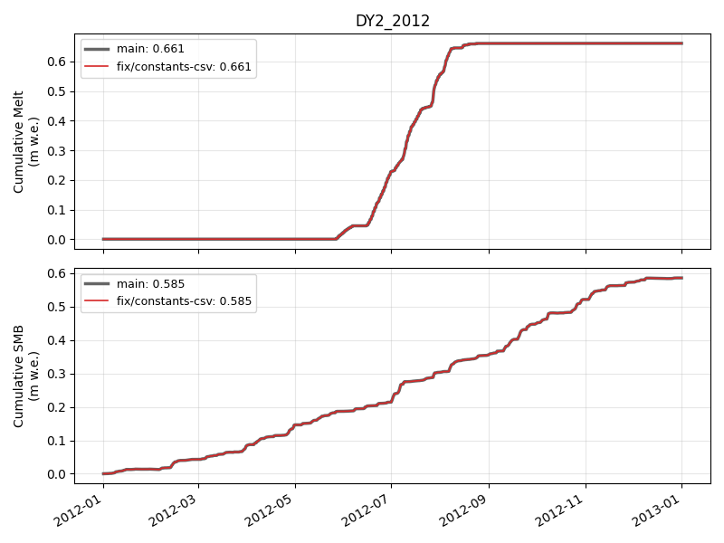

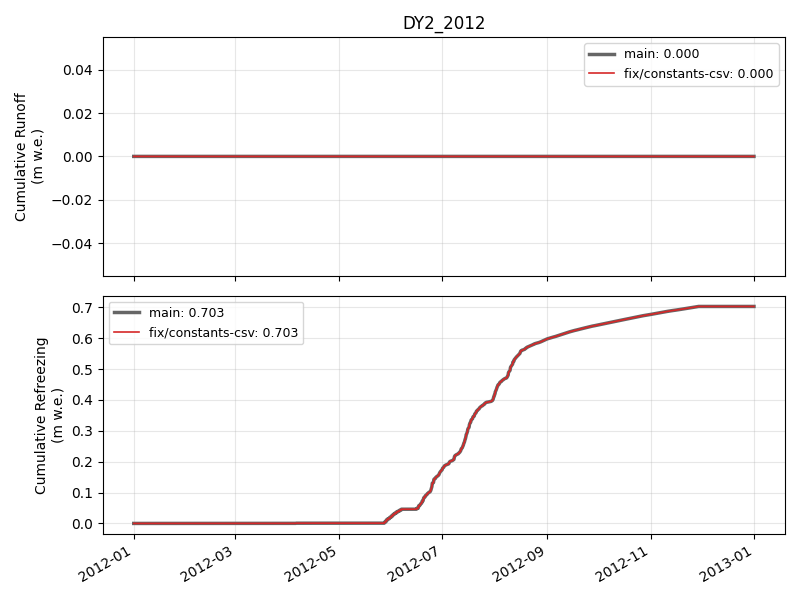

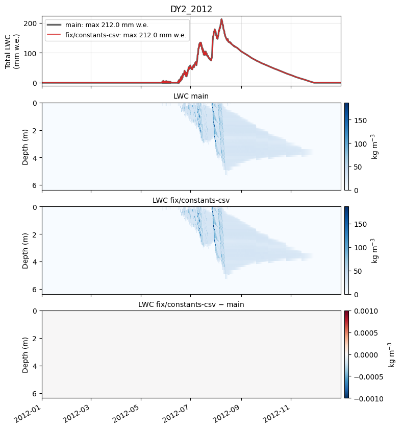

### DY2_2019

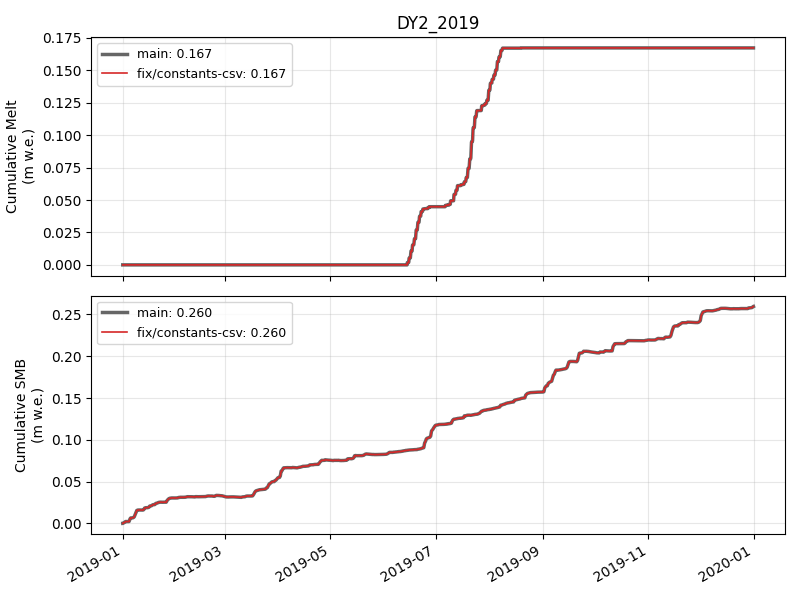

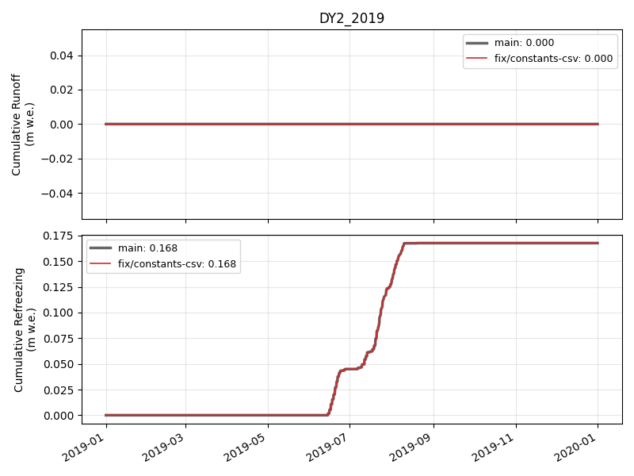

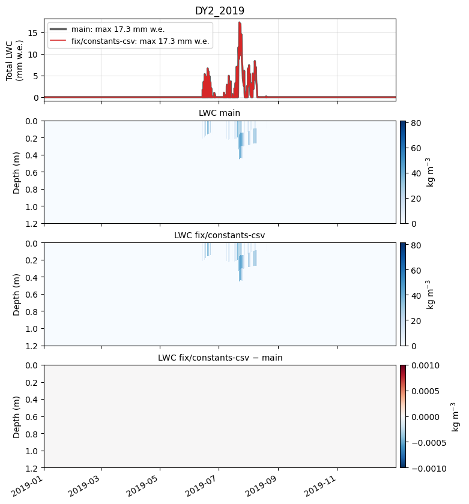

### KAN_L_2012

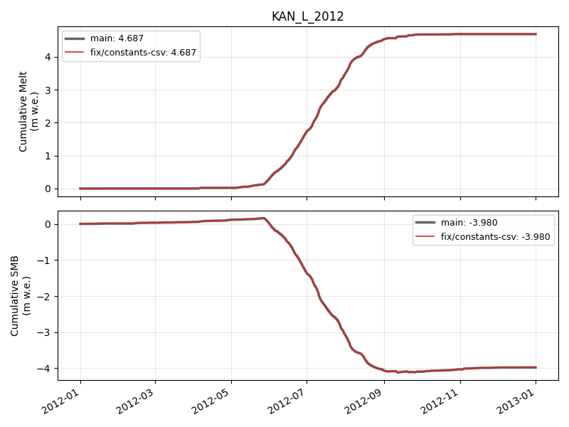

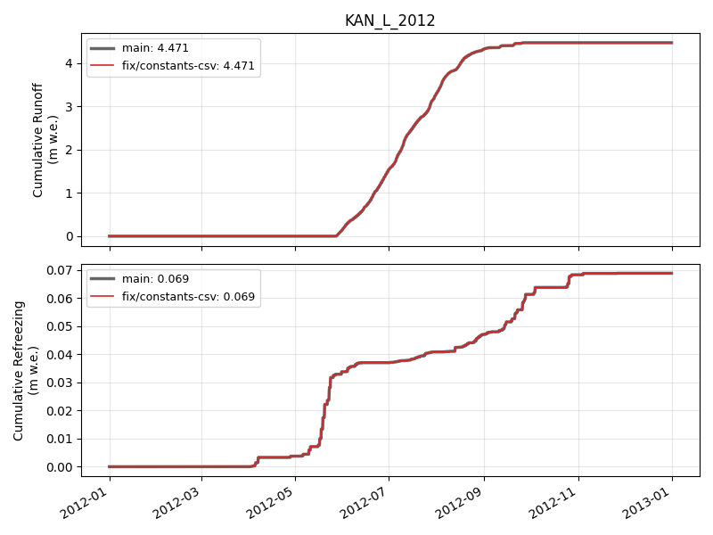

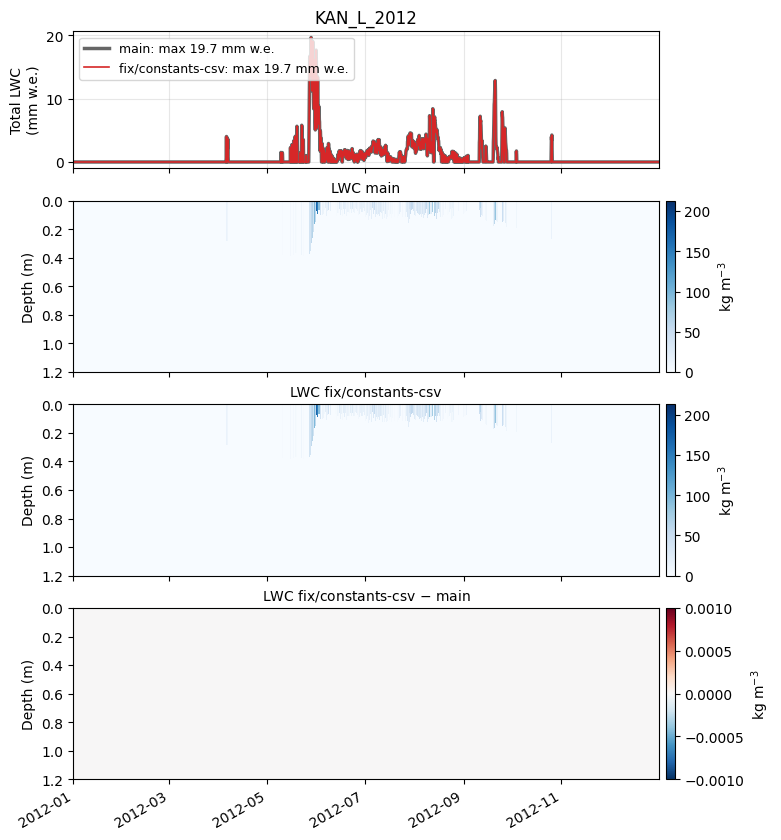

### KAN_L_2019

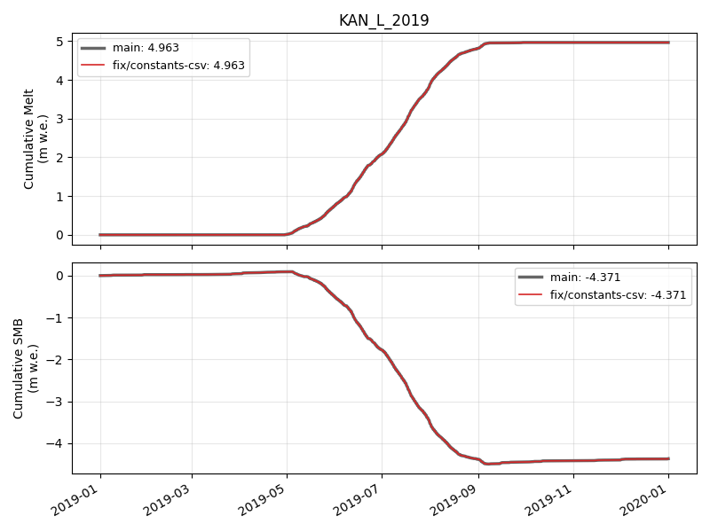

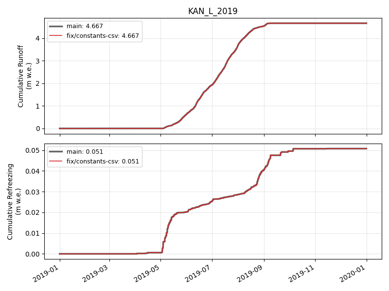

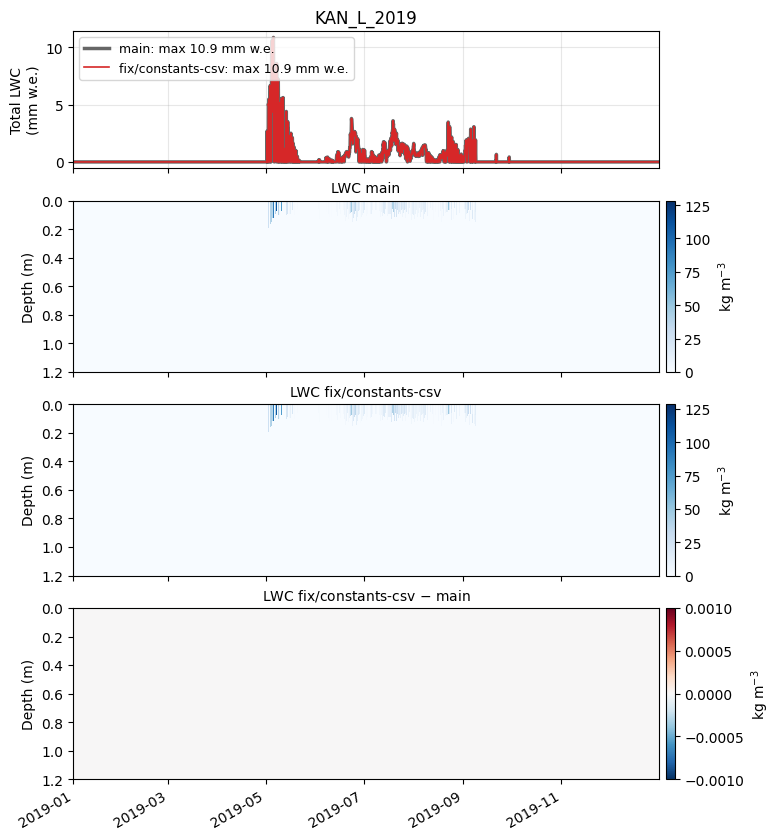

