## Changes

Makes runs, and the test runs in particular, start from the initial state csv files in `input/initial state` instead of trying to load a spin-up pickle, and renames the site csv files so that the model actually reads them.

**Spin-up is now optional** (`main_SEB_firn.py`):
- `run_SEB_firn(spin_up_path=None)`: `spin_up_path` is optional and `c.use_spin_up_init = spin_up_path is not None`. Without it, the run starts directly from the csv initial state. Before, `use_spin_up_init` was always `True`: every run first looked for `<spin_up_path>/<RunName>/<station>_final.pkl` and only fell back to the csv files when the pickle could not be loaded.
- Runs started from a pickle are unchanged (`multi_core_run.py` and `__main__` still pass `spin_up_path`). Note that in that case `snowthick` is not initialized by `IniVar` (separate issue, to be fixed in another PR).

**Test runs without spin-up** (`tools/test_runs/run_test_cases.py`): the test cases are run with `spin_up_path=None`, so no spin-up file is involved. Versions where `spin_up_path` is required (e.g. `main` before this PR) fail to load a pickle from `None` and fall back to the same csv initial state.

**Site initial-state csv files renamed and reformatted** (`input/initial state`): `InitializationSubsurface` looks for `<station>_initial_density_bulk.csv` (columns `depth,density_bulk`) and `<station>_initial_T_ice.csv` (columns `depth,T_ice`, in °C). Most site files had other names, and some were `;`-separated with other column names, so they were never used and those sites silently used the generic `accumulation_*`/`ablation_*` profiles:

| Before | After |
|---|---|
| `DY2_initial_temperature.csv` | `DY2_initial_T_ice.csv` |
| `FA_initial_density.csv`, `FA_initial_temperature.csv` | `FA_initial_density_bulk.csv`, `FA_initial_T_ice.csv` |
| `IMAU_aws4_initial_density.csv`, `IMAU_aws4_initial_temperature.csv` | `IMAU_aws4_initial_density_bulk.csv`, `IMAU_aws4_initial_T_ice.csv` |
| `KAN_M_initial_density.csv`, `KAN_M_initial_temperature.csv` | `KAN_M_initial_density_bulk.csv`, `KAN_M_initial_T_ice.csv` |
| `KAN_U_initial_density.csv`, `KAN_U_initial_temperature.csv` | `KAN_U_initial_density_bulk.csv`, `KAN_U_initial_T_ice.csv` |

Values are unchanged; `;` files are converted to `,` with the expected column names. Runs at FA, IMAU_aws4, KAN_M and KAN_U now start from their own profiles. `KAN_U_initial_density_2013.csv` and the files in `old/` are left as they are. These profiles can be made more realistic in a later PR (e.g. `KAN_U_initial_density_bulk.csv` is identical to the previous DY2 profile).

**Observed initial profiles at DYE-2** (`tools/make_DY2_initial_profiles.py`): the previous DY2 density profile was a smooth curve without any layer reaching 830 kg m⁻³, and the DY2 temperature file was identical to the generic accumulation profile (−19.5 °C at the surface, −16 °C at depth). They are replaced by observations:
- `DY2_initial_density_bulk.csv` (1 cm resolution): GEUS snow pit (0–0.98 m) and firn core (0.98–9.55 m) drilled at DYE-2 on 2022-06-15 (Vandecrux et al., 2023, https://doi.org/10.22008/FK2/9QEOWZ). Samples flagged as bad quality or broken are skipped and gaps interpolated. Below 9.55 m the previous profile is kept. The 2022 core is the deepest profile available closest to the test years (the earlier DYE-2 profiles in the GEUS snow pit collection are shallower than 1.6 m). It contains several dense layers (up to 891 kg m⁻³): 4 of the 58 model layers in the top 10 m now exceed 830 kg m⁻³, against none before.
- `DY2_initial_T_ice.csv`: firn temperature at DYE-2 on 2019-01-01 from the thermistor string of Covi et al. (2022, doi:10.18739/A2BN9X444): 27 depths from 2.3 to 18.3 m, −17.6 to −14.3 °C.

The script documents and reproduces both files (it needs the GEUS snow pit csv folder and the SUMup Covi temperature file).

### Effect on the test runs

- **KAN_L**: identical to `main` (no site file, the generic ablation profiles are used as before).
- **DY2**: the differences come from the new initial profiles (`main` uses the previous files). With denser, partly impermeable layers in the top metres, meltwater is retained closer to the surface: in 2012, 0.038 m w.e. runs off (none on `main`) and refreezing decreases by 0.014 m w.e.; in 2019, melt and refreezing both increase by 0.029 m w.e. The warmer firn below 2 m (about −15 °C instead of −16 to −19 °C) also changes the surface temperature and sublimation.

## Effect on the test runs

Totals over each test case in m w.e. (fix/initial-state-from-csv vs main). Constant Tdeep = 263 K, no spin-up (initial profiles from input/initial state).

| Test case | Variable | main | fix/initial-state-from-csv | Difference | Difference (%) |
|---|---|---|---|---|---|
| DY2_2012 | Melt | 0.661 | 0.693 | +0.032 | +4.8 |
| DY2_2012 | Runoff | 0.000 | 0.038 | +0.038 | n/a |
| DY2_2012 | Refreezing | 0.703 | 0.689 | -0.014 | -2.0 |
| DY2_2012 | Sublimation | 0.001 | -0.006 | -0.007 | -509.5 |
| DY2_2012 | SMB | 0.585 | 0.554 | -0.031 | -5.3 |
| DY2_2019 | Melt | 0.167 | 0.197 | +0.029 | +17.5 |
| DY2_2019 | Runoff | 0.000 | 0.000 | +0.000 | n/a |
| DY2_2019 | Refreezing | 0.168 | 0.197 | +0.029 | +17.5 |
| DY2_2019 | Sublimation | 0.013 | 0.001 | -0.012 | -91.8 |
| DY2_2019 | SMB | 0.260 | 0.272 | +0.012 | +4.6 |
| KAN_L_2012 | Melt | 4.687 | 4.687 | +0.000 | +0.0 |
| KAN_L_2012 | Runoff | 4.471 | 4.471 | +0.000 | +0.0 |
| KAN_L_2012 | Refreezing | 0.069 | 0.069 | +0.000 | +0.0 |
| KAN_L_2012 | Sublimation | 0.039 | 0.039 | +0.000 | +0.0 |
| KAN_L_2012 | SMB | -3.980 | -3.980 | +0.000 | +0.0 |
| KAN_L_2019 | Melt | 4.963 | 4.963 | +0.000 | +0.0 |
| KAN_L_2019 | Runoff | 4.667 | 4.667 | +0.000 | +0.0 |
| KAN_L_2019 | Refreezing | 0.051 | 0.051 | +0.000 | +0.0 |
| KAN_L_2019 | Sublimation | -0.047 | -0.047 | +0.000 | +0.0 |
| KAN_L_2019 | SMB | -4.371 | -4.371 | +0.000 | +0.0 |

### DY2_2012

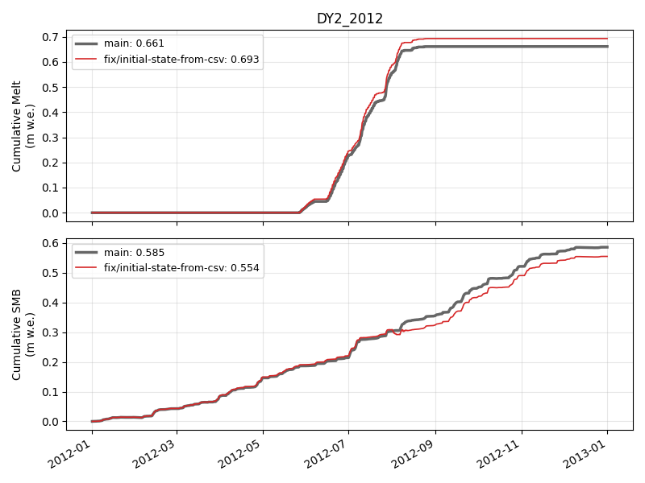

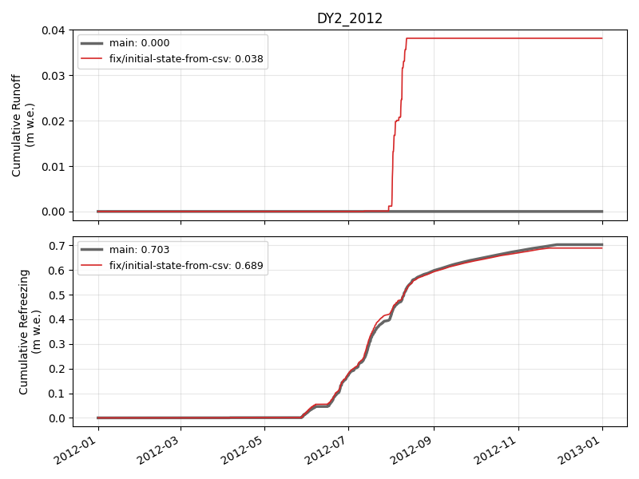

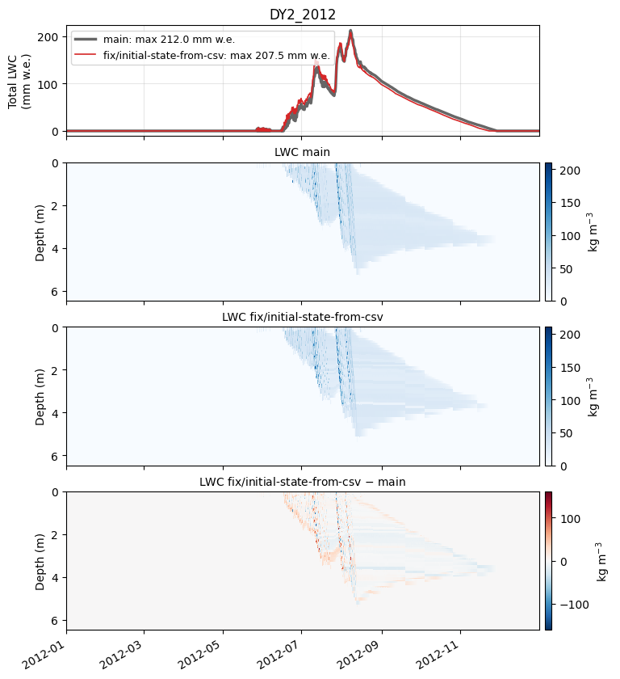

### DY2_2019

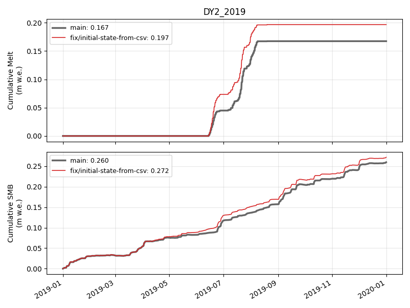

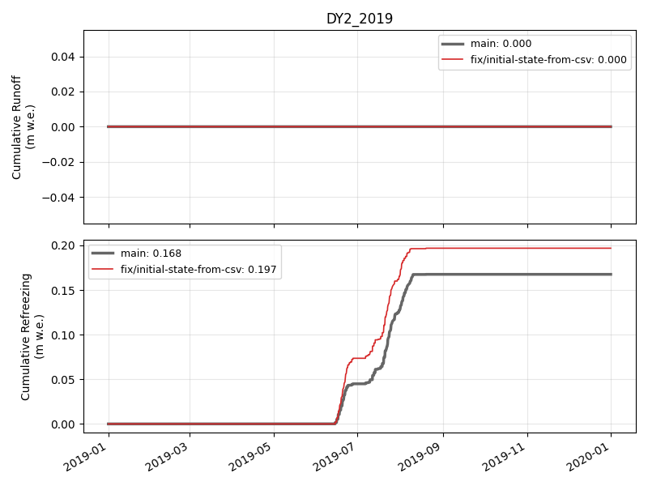

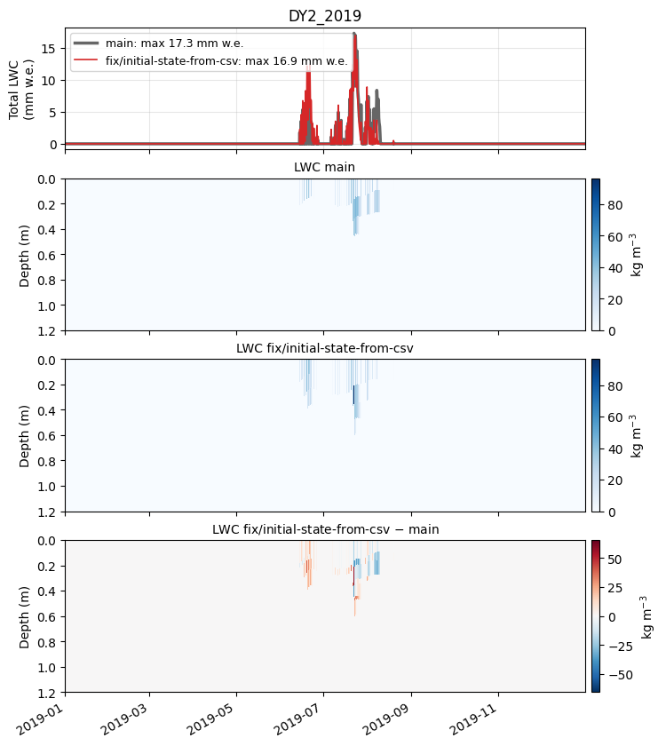

### KAN_L_2012

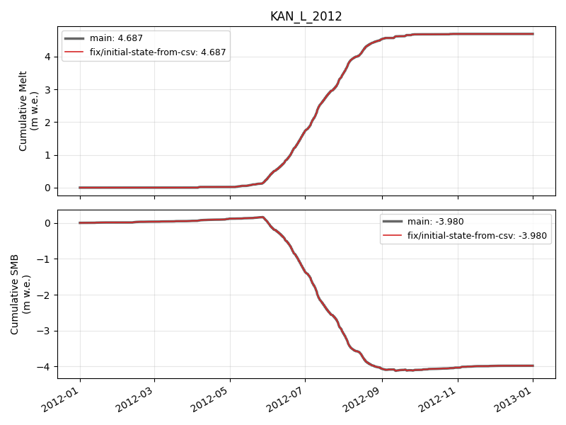

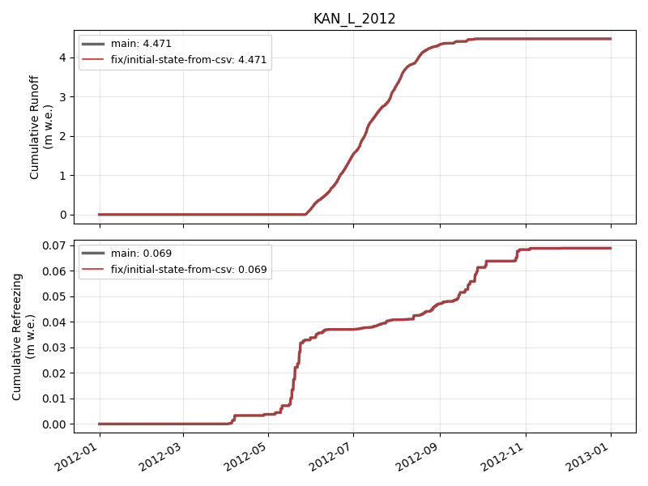

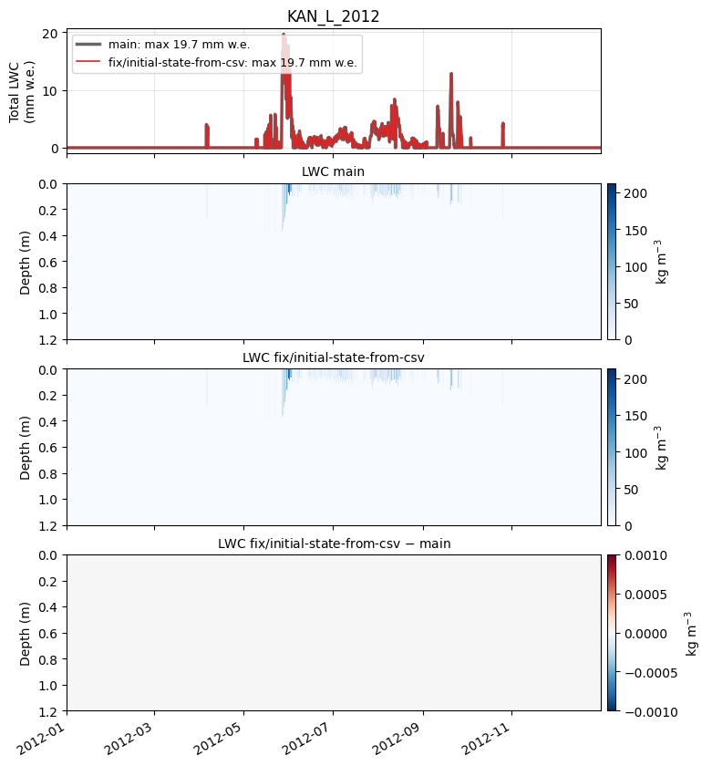

### KAN_L_2019

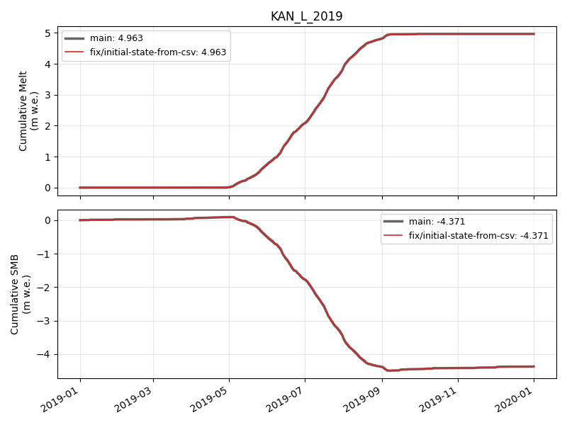

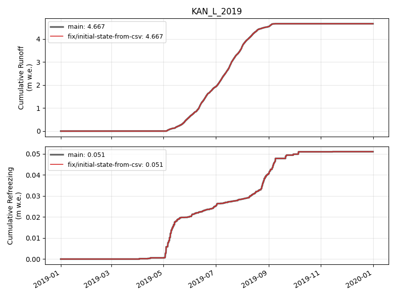

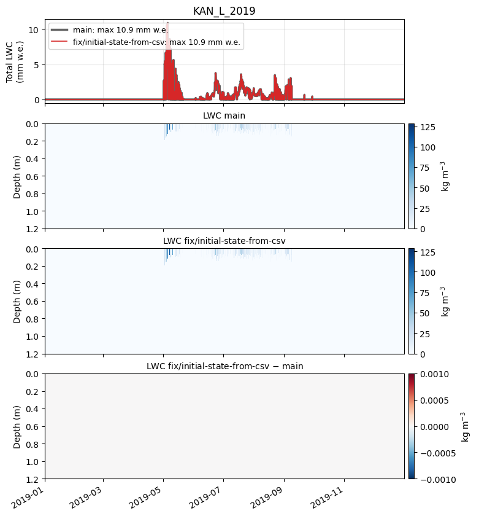

