## Changes

Removes a spurious creation of ice in `melting()` (`lib/subsurface.py`).

When the melt energy reaches a layer that is below the melting point, part of it first warms the layer to 0 °C: the layer temperature is raised and the corresponding amount is subtracted from the melt (`zsnmel`). The same amount was then also added to the layer as ice:

```python
# adding what was used for the warming as ice content
psnic[jk] = psnic[jk] + warming_energy / 334000 / 999.8395
```

That energy had already been used to warm the layer, so this created ice mass out of nothing and counted the energy twice. The two lines are removed: the warming energy now only warms the layer, and only the remaining melt energy changes phase. The melted snow and ice still become liquid water, which is then handled by percolation and refreezing.

The effect is small in the test cases: this only happens when melt energy reaches a layer that is still below 0 °C (typically at melt onset), while the top layer is usually at the melting point when the surface melts. DY2 is unchanged. At KAN_L, refreezing, runoff and sublimation change by less than 0.001 m w.e. per year, with small LWC differences in the top 20 cm during the melt season.

## Effect on the test runs

Totals over each test case in m w.e. (fix/melting-no-ice-from-warming vs main). Constant Tdeep = 263 K, no spin-up (initial profiles from input/initial state).

| Test case | Variable | main | fix/melting-no-ice-from-warming | Difference | Difference (%) |
|---|---|---|---|---|---|
| DY2_2012 | Melt | 0.661 | 0.661 | +0.000 | +0.0 |
| DY2_2012 | Runoff | 0.000 | 0.000 | +0.000 | n/a |
| DY2_2012 | Refreezing | 0.703 | 0.703 | +0.000 | +0.0 |
| DY2_2012 | Sublimation | 0.001 | 0.001 | +0.000 | +0.0 |
| DY2_2012 | SMB | 0.585 | 0.585 | +0.000 | +0.0 |
| DY2_2019 | Melt | 0.167 | 0.167 | +0.000 | +0.0 |
| DY2_2019 | Runoff | 0.000 | 0.000 | +0.000 | n/a |
| DY2_2019 | Refreezing | 0.168 | 0.168 | +0.000 | +0.0 |
| DY2_2019 | Sublimation | 0.013 | 0.013 | +0.000 | +0.0 |
| DY2_2019 | SMB | 0.260 | 0.260 | +0.000 | +0.0 |
| KAN_L_2012 | Melt | 4.687 | 4.687 | +0.000 | +0.0 |
| KAN_L_2012 | Runoff | 4.471 | 4.471 | +0.000 | +0.0 |
| KAN_L_2012 | Refreezing | 0.069 | 0.069 | +0.000 | +0.0 |
| KAN_L_2012 | Sublimation | 0.039 | 0.039 | +0.000 | +0.0 |
| KAN_L_2012 | SMB | -3.980 | -3.980 | +0.000 | +0.0 |
| KAN_L_2019 | Melt | 4.963 | 4.963 | +0.000 | +0.0 |
| KAN_L_2019 | Runoff | 4.667 | 4.667 | -0.000 | -0.0 |
| KAN_L_2019 | Refreezing | 0.051 | 0.051 | +0.000 | +0.5 |
| KAN_L_2019 | Sublimation | -0.047 | -0.047 | +0.000 | +0.1 |
| KAN_L_2019 | SMB | -4.371 | -4.371 | +0.000 | +0.0 |


### DY2_2012


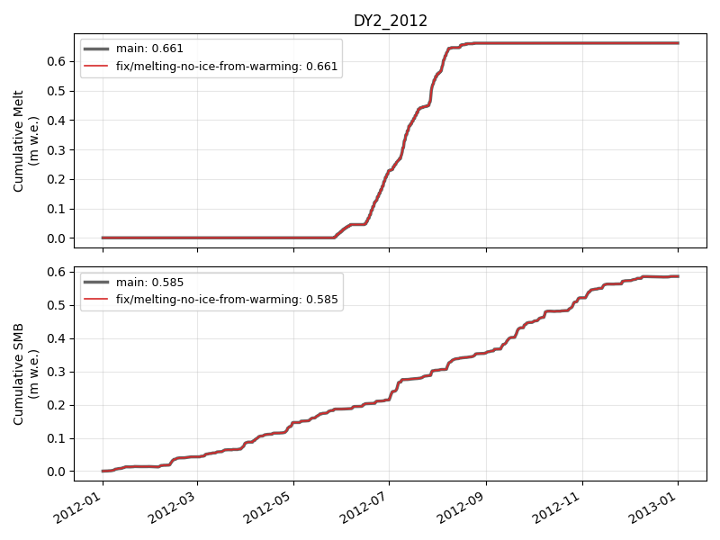

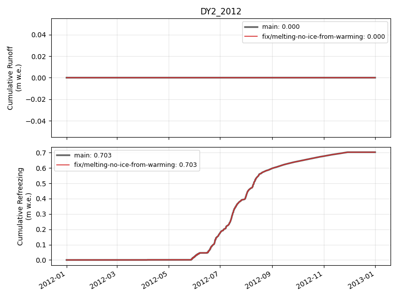

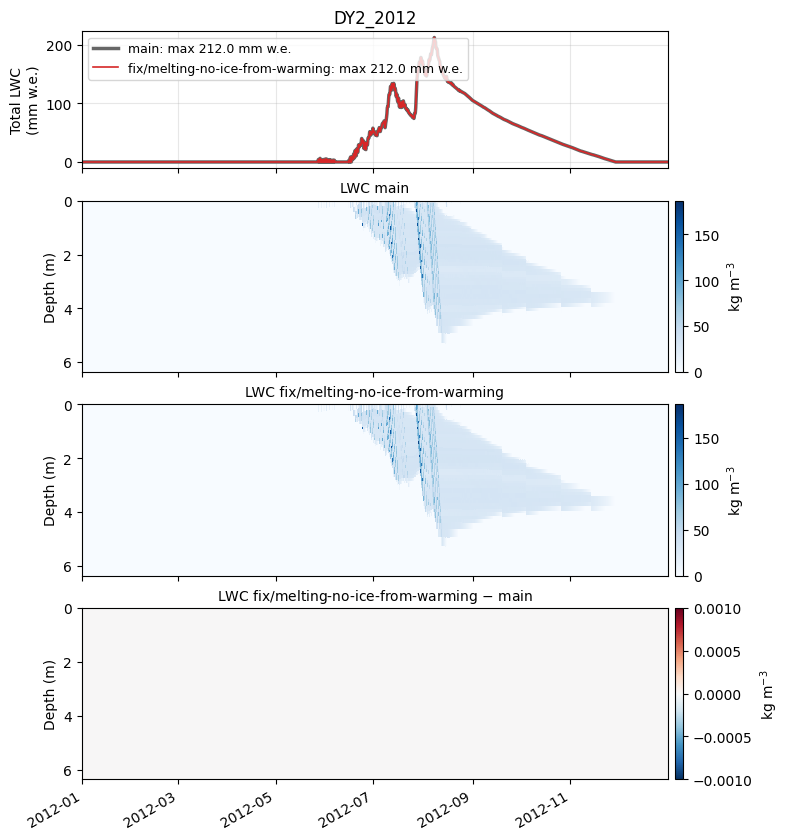

### DY2_2019


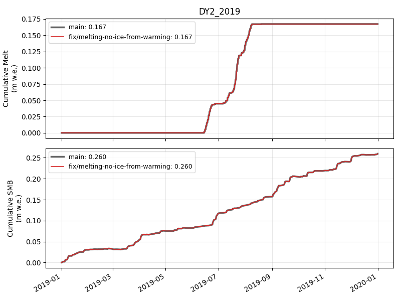

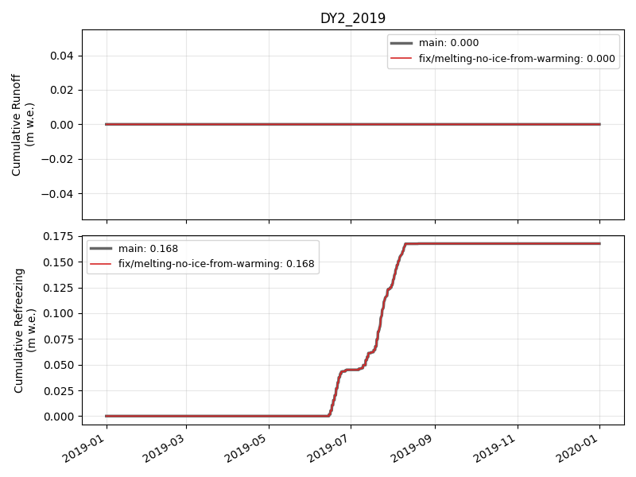

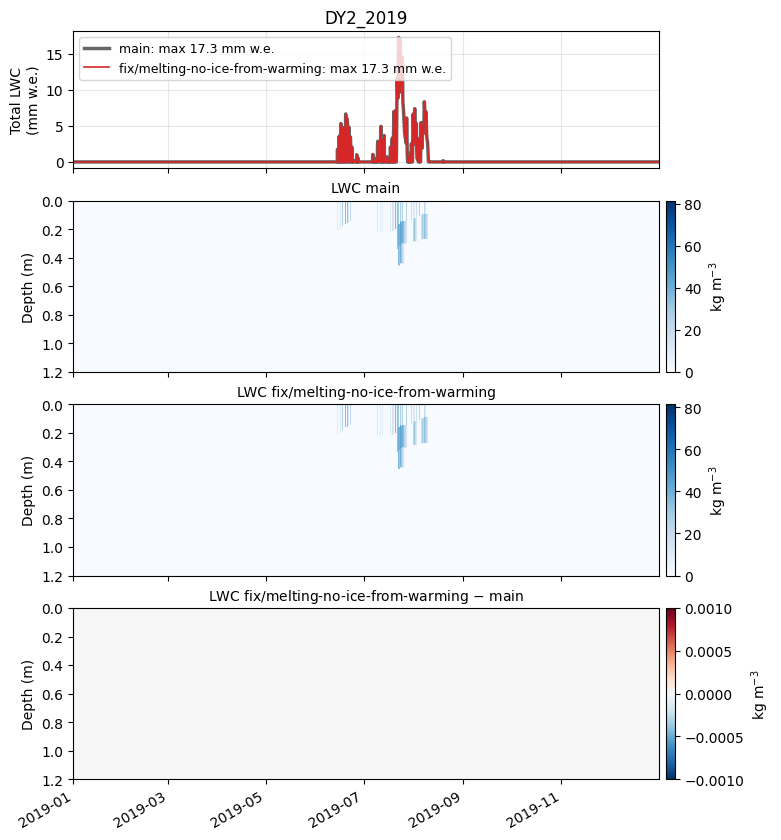

### KAN_L_2012


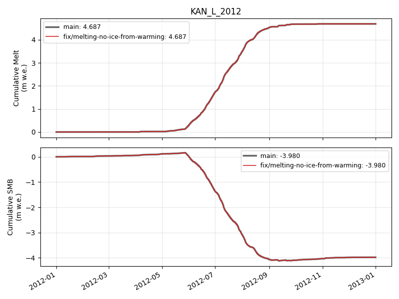

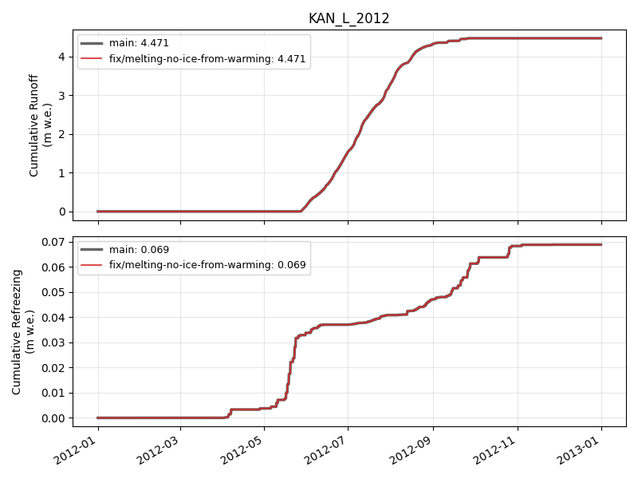

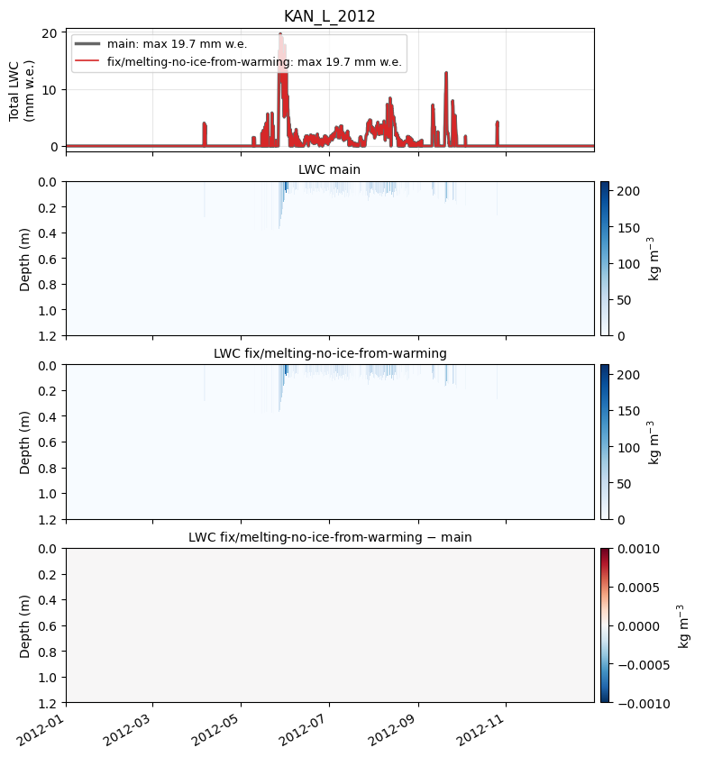

### KAN_L_2019


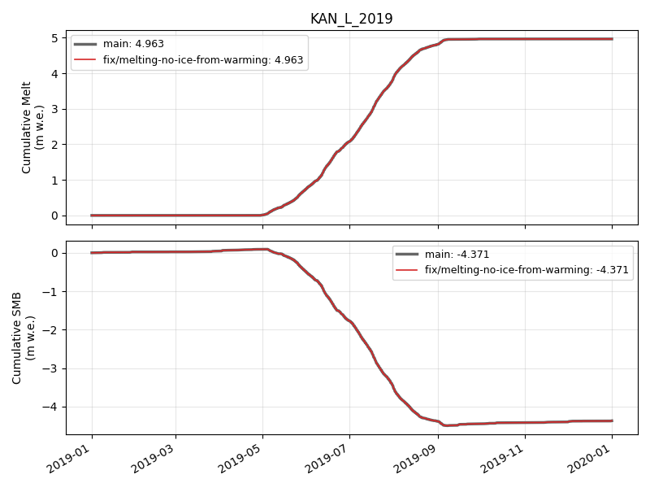

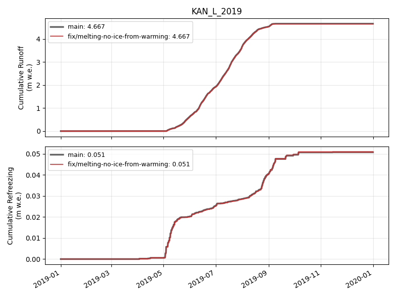

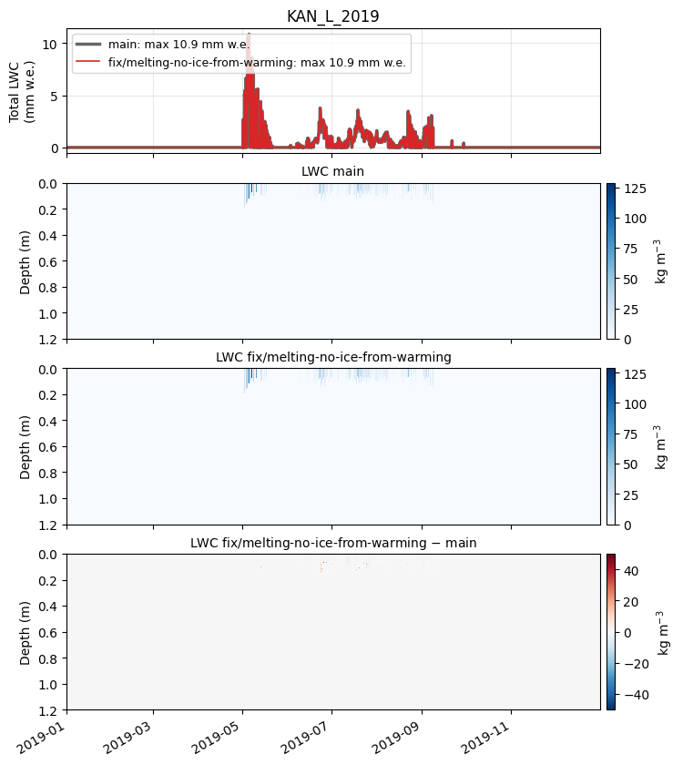

