## Changes

Fixes the layer shift in `merge_small_layers()` (`lib/subsurface.py`).

When a layer `jk` is thinner than `lim_new_lay`, its content is added to layer `jk+1`. Layers `0..jk-1` must then be shifted down by one so that the top layer becomes the free one, because `split_layer()` overwrites the top layer and discards its content. The shift was guarded by `if jk > 1:` instead of `if jk > 0:`. For `jk == 1`, the column was not shifted, so:

- the top layer (layer 0) was discarded by `split_layer()`: its snow, ice and water were lost;
- the merged layer 1 kept its content, which had already been added to layer 2: that mass was counted twice.

The condition is now `if jk > 0:`, so mass is conserved for any `jk`. For `jk == 0` no shift is needed, as before.

In the test cases the output is identical to `main`: counting on `main`, the only layer that ever becomes too small is the top one (27 times at DY2_2012, 136 at KAN_L_2012, 177 at KAN_L_2019, none at DY2_2019), never layer 1. The bug needs the second layer to drop below 0.02 m w.e., e.g. after strong internal melting, which may become more frequent with shortwave penetration.

## Effect on the test runs

Totals over each test case in m w.e. (fix/merge-small-layers-shift vs main). Constant Tdeep = 263 K, no spin-up (initial profiles from input/initial state).

**All compared variables are identical.**

| Test case | Variable | main | fix/merge-small-layers-shift | Difference | Difference (%) |
|---|---|---|---|---|---|
| DY2_2012 | Melt | 0.661 | 0.661 | +0.000 | +0.0 |
| DY2_2012 | Runoff | 0.000 | 0.000 | +0.000 | n/a |
| DY2_2012 | Refreezing | 0.703 | 0.703 | +0.000 | +0.0 |
| DY2_2012 | Sublimation | 0.001 | 0.001 | +0.000 | +0.0 |
| DY2_2012 | SMB | 0.585 | 0.585 | +0.000 | +0.0 |
| DY2_2019 | Melt | 0.167 | 0.167 | +0.000 | +0.0 |
| DY2_2019 | Runoff | 0.000 | 0.000 | +0.000 | n/a |
| DY2_2019 | Refreezing | 0.168 | 0.168 | +0.000 | +0.0 |
| DY2_2019 | Sublimation | 0.013 | 0.013 | +0.000 | +0.0 |
| DY2_2019 | SMB | 0.260 | 0.260 | +0.000 | +0.0 |
| KAN_L_2012 | Melt | 4.687 | 4.687 | +0.000 | +0.0 |
| KAN_L_2012 | Runoff | 4.471 | 4.471 | +0.000 | +0.0 |
| KAN_L_2012 | Refreezing | 0.069 | 0.069 | +0.000 | +0.0 |
| KAN_L_2012 | Sublimation | 0.039 | 0.039 | +0.000 | +0.0 |
| KAN_L_2012 | SMB | -3.980 | -3.980 | +0.000 | +0.0 |
| KAN_L_2019 | Melt | 4.963 | 4.963 | +0.000 | +0.0 |
| KAN_L_2019 | Runoff | 4.667 | 4.667 | +0.000 | +0.0 |
| KAN_L_2019 | Refreezing | 0.051 | 0.051 | +0.000 | +0.0 |
| KAN_L_2019 | Sublimation | -0.047 | -0.047 | +0.000 | +0.0 |
| KAN_L_2019 | SMB | -4.371 | -4.371 | +0.000 | +0.0 |

### DY2_2012

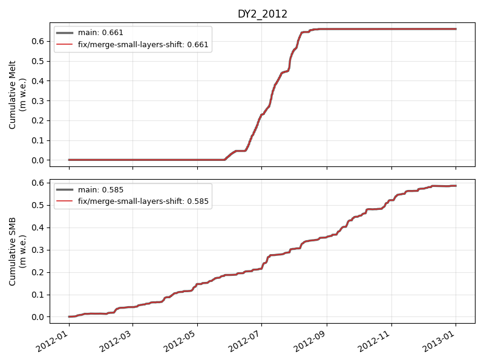

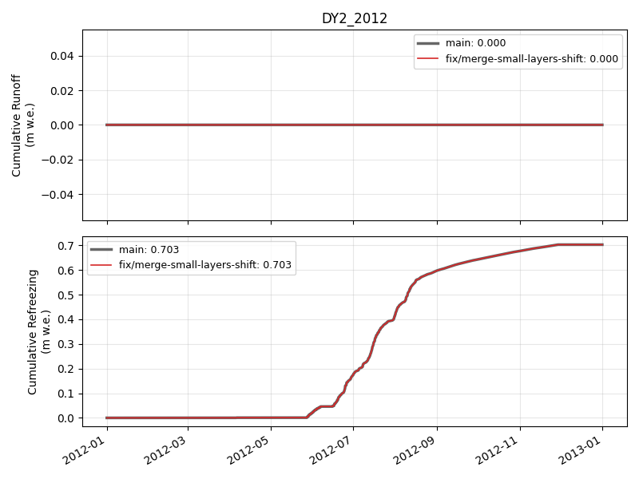

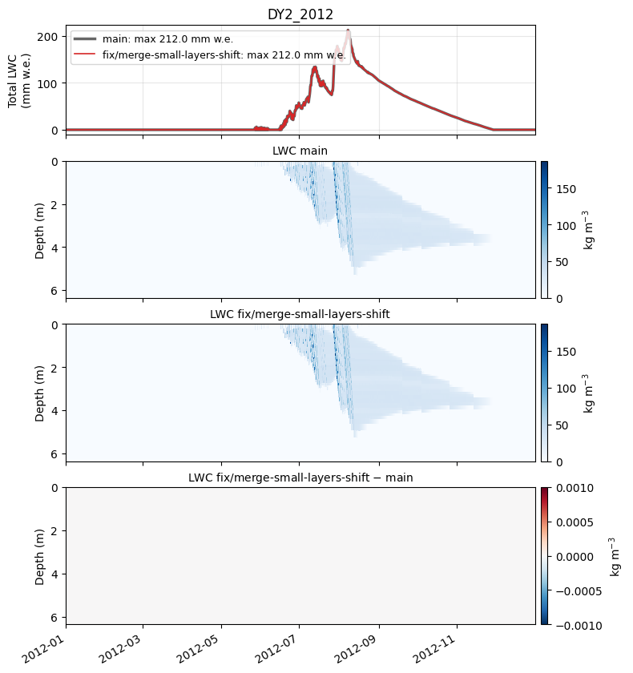

### DY2_2019

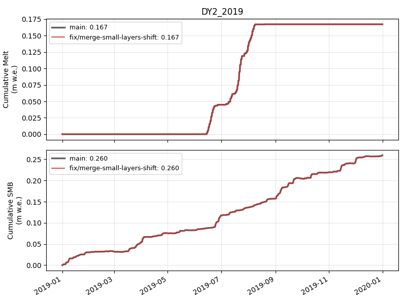

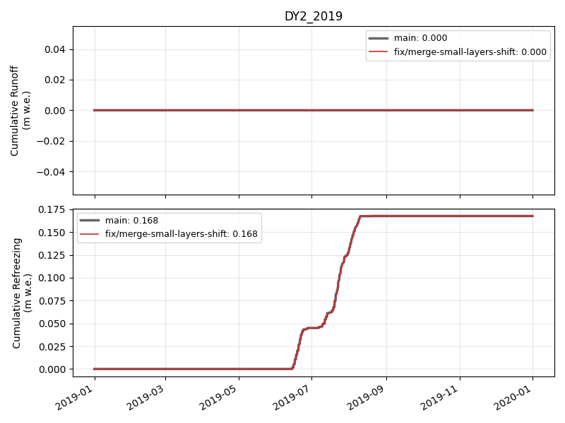

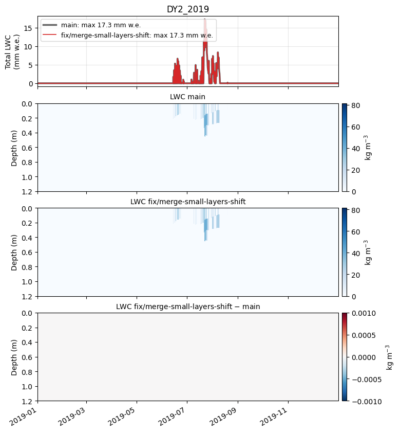

### KAN_L_2012

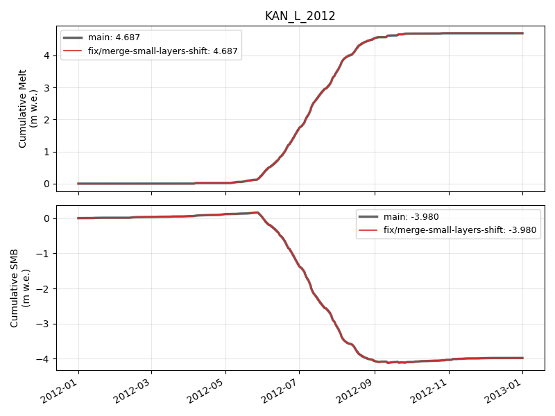

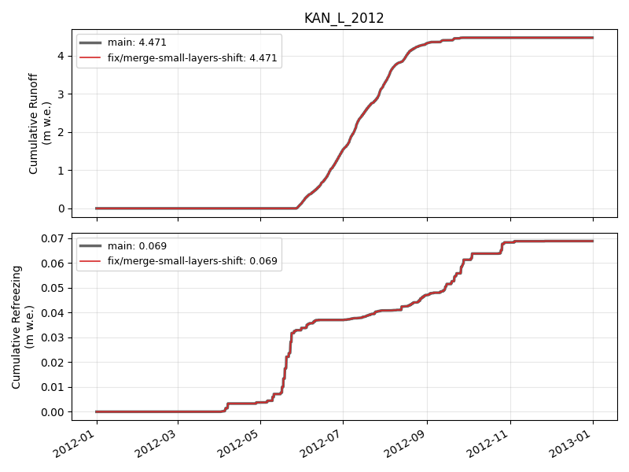

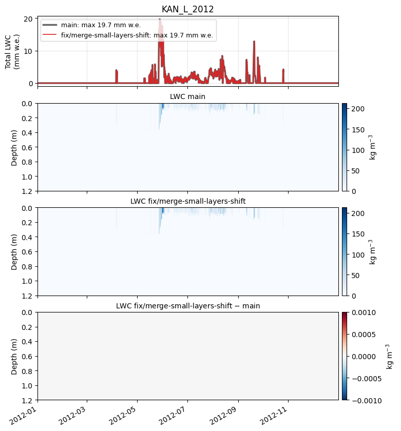

### KAN_L_2019

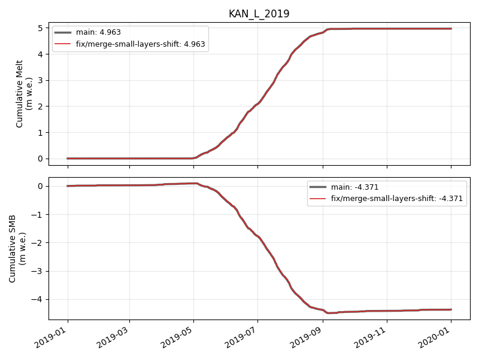

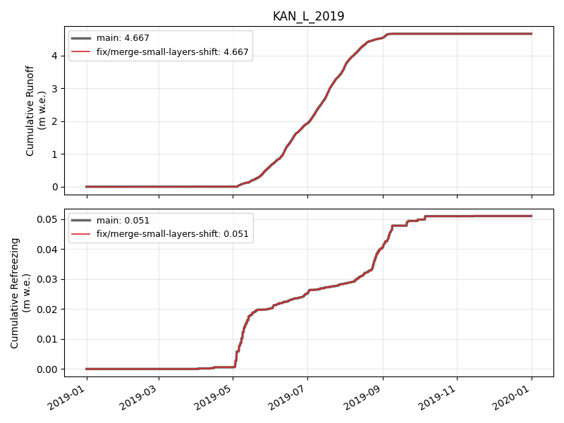

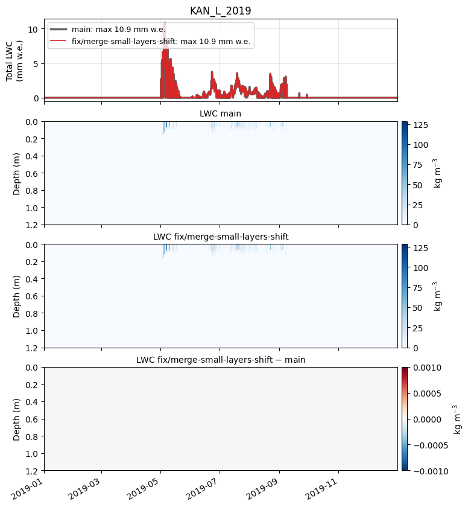

