## Changes

Removes the superimposed ice (SI) formation from the subsurface scheme (`superimposedice()` in `lib/subsurface.py`) and the `zsupimp` variable.

`superimposedice()` turned liquid water lying above a dense layer (density ≥ `rho_pco`) into ice, using a conductive heat flux estimated from the temperature gradient into that cold layer (`ki * dTdz * zdtime`), and released the latent heat into the cold layer. That conduction is already handled by the model:

- `tsoil_diffusion()` (implicit heat diffusion) conducts heat from the wet layer at 0 °C into the cold layer below, cooling the wet layer;
- `refreeze()` then refreezes the water in the cooled layer, using its cold content.

The conductive heat flux into cold ice was therefore counted twice. SI is a leftover from the earlier slush-bucket version of the scheme, which had no layer-resolved refreezing.

Changes:
- `lib/subsurface.py`: the call to `superimposedice()` and the function are removed.
- `zsupimp` (superimposed ice per layer) is removed from `subsurface_opt()`, `GEUS_model()`, `IniVar()` and `run_SEB_firn()`, and from the old scripts `main_firn.py`, `tools/test_main_firn.py` and `tools/test_SensLatFluxes.py`. It was never written to the output files.

### Effect on the test runs

- **DY2**: with the observed initial profile (#13), a few layers in the top metres exceed `rho_pco`. On `main`, SI formed 0.007 m w.e. in 2012 and none in 2019. Without SI in 2012, refreezing increases by 0.005 and runoff by 0.003 m w.e. (melt unchanged); 2019 is identical.
- **KAN_L** (bare ice): on `main`, SI formed 0.380 m w.e. in 2012 and 0.297 m w.e. in 2019. This ice was not included in `refreezing_mweq`, which only sums `refreeze()`, so it does not appear in the table. Without SI, the water it captured goes elsewhere (KAN_L_2012):

| m w.e. | main | this PR | Δ |
|---|---|---|---|
| Superimposed ice | 0.380 | 0 | −0.380 |
| Refreezing (`refreeze()`) | 0.069 | 0.187 | +0.118 |
| Runoff | 4.471 | 4.554 | +0.084 |
| Melt | 4.687 | 4.509 | −0.178 |

  0.118 + 0.084 + 0.178 = 0.380: about half of the SI was melted again later in the season on `main` (melt counted twice), the rest now either refreezes through the diffusion + `refreeze()` route or runs off. This is why refreezing and runoff both increase while melt decreases. SMB decreases by 0.090 (2012) and 0.135 (2019) m w.e.

## Effect on the test runs

Totals over each test case in m w.e. (fix/remove-superimposed-ice vs main). Constant Tdeep = 263 K, no spin-up (initial profiles from input/initial state).

| Test case | Variable | main | fix/remove-superimposed-ice | Difference | Difference (%) |
|---|---|---|---|---|---|
| DY2_2012 | Melt | 0.693 | 0.693 | +0.000 | +0.0 |
| DY2_2012 | Runoff | 0.038 | 0.041 | +0.003 | +6.7 |
| DY2_2012 | Refreezing | 0.689 | 0.693 | +0.005 | +0.7 |
| DY2_2012 | Sublimation | -0.006 | -0.006 | +0.000 | +0.5 |
| DY2_2012 | SMB | 0.554 | 0.552 | -0.003 | -0.5 |
| DY2_2019 | Melt | 0.197 | 0.197 | +0.000 | +0.0 |
| DY2_2019 | Runoff | 0.000 | 0.000 | +0.000 | n/a |
| DY2_2019 | Refreezing | 0.197 | 0.197 | +0.000 | +0.0 |
| DY2_2019 | Sublimation | 0.001 | 0.001 | +0.000 | +0.0 |
| DY2_2019 | SMB | 0.272 | 0.272 | +0.000 | +0.0 |
| KAN_L_2012 | Melt | 4.687 | 4.509 | -0.178 | -3.8 |
| KAN_L_2012 | Runoff | 4.471 | 4.554 | +0.084 | +1.9 |
| KAN_L_2012 | Refreezing | 0.069 | 0.187 | +0.118 | +171.3 |
| KAN_L_2012 | Sublimation | 0.039 | 0.045 | +0.007 | +17.7 |
| KAN_L_2012 | SMB | -3.980 | -4.070 | -0.090 | -2.3 |
| KAN_L_2019 | Melt | 4.963 | 4.869 | -0.094 | -1.9 |
| KAN_L_2019 | Runoff | 4.667 | 4.792 | +0.125 | +2.7 |
| KAN_L_2019 | Refreezing | 0.051 | 0.129 | +0.078 | +152.3 |
| KAN_L_2019 | Sublimation | -0.047 | -0.038 | +0.009 | +19.4 |
| KAN_L_2019 | SMB | -4.371 | -4.506 | -0.135 | -3.1 |

### DY2_2012

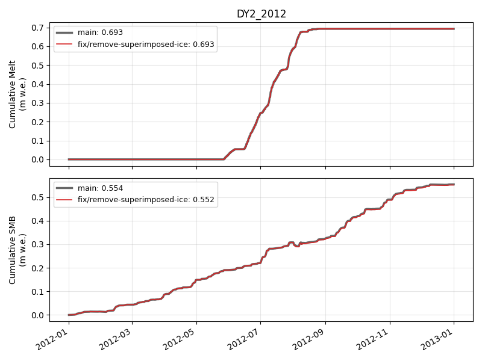

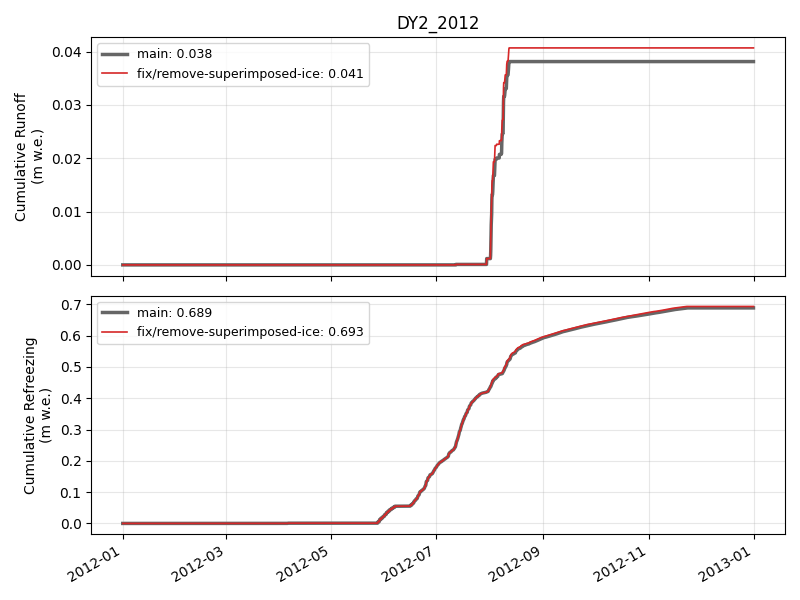

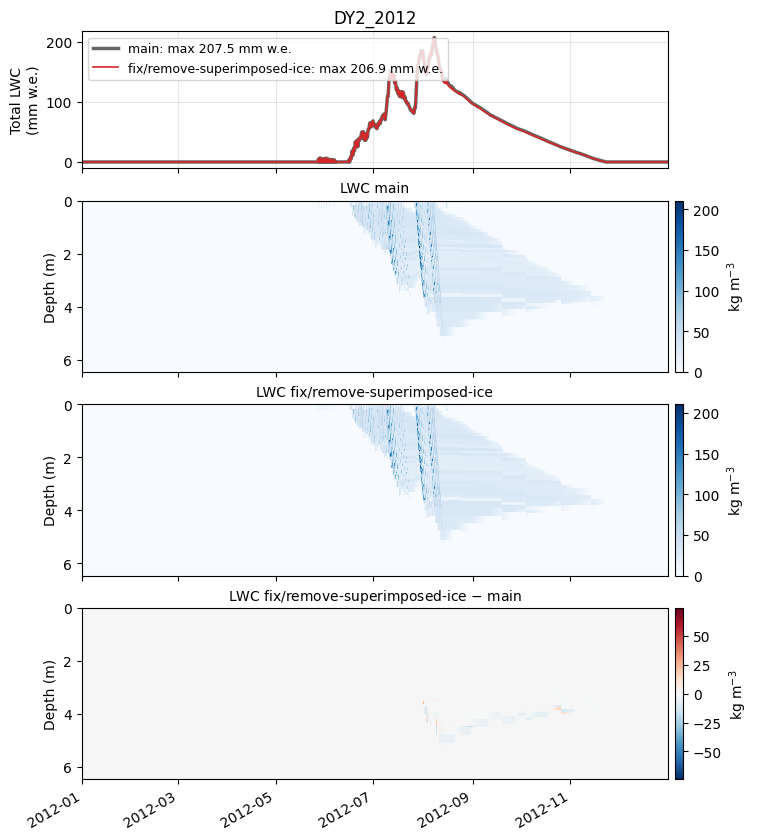

### DY2_2019

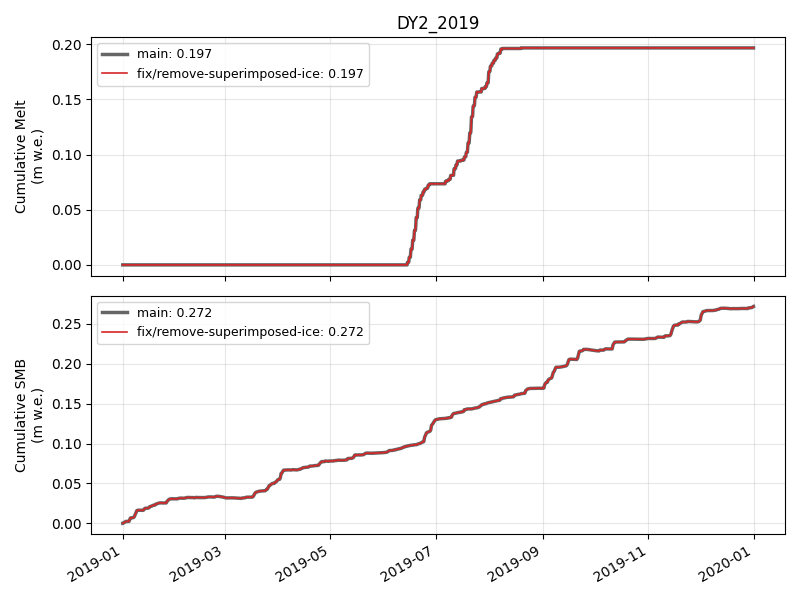

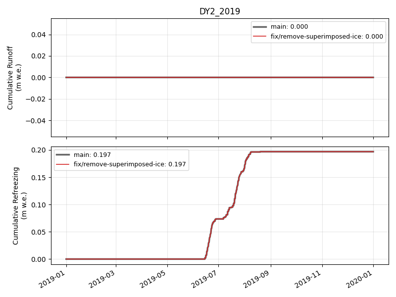

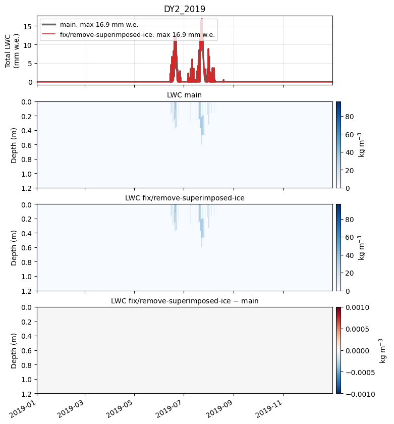

### KAN_L_2012

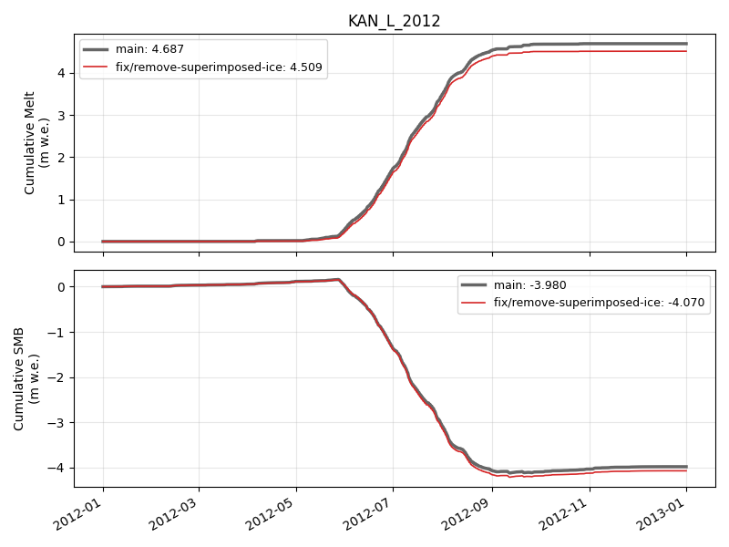

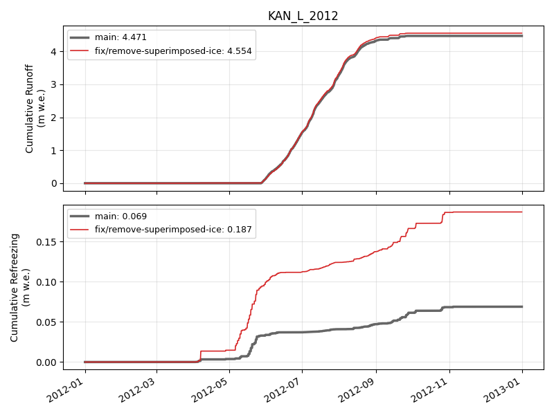

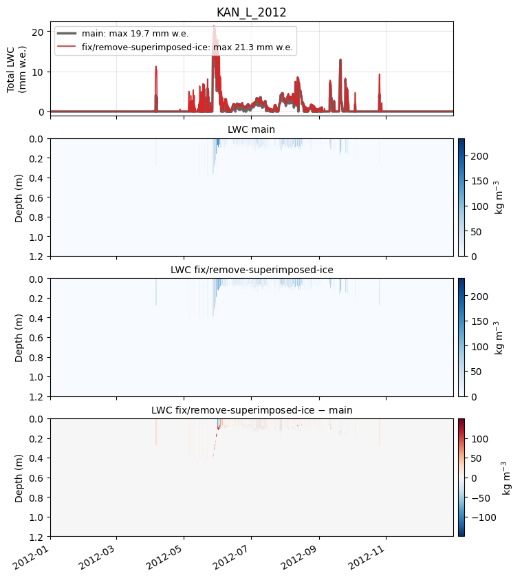

### KAN_L_2019

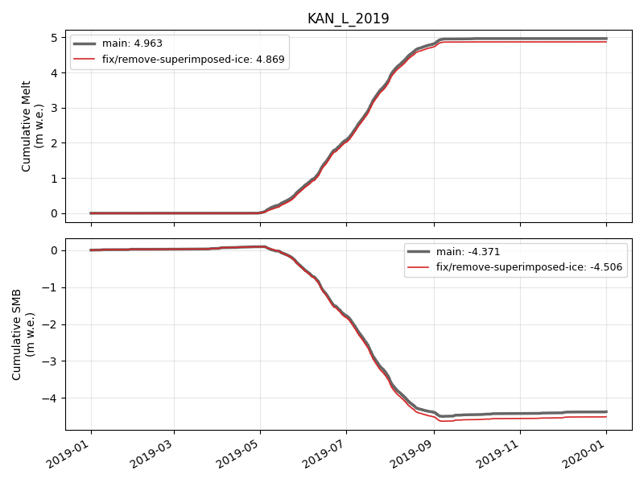

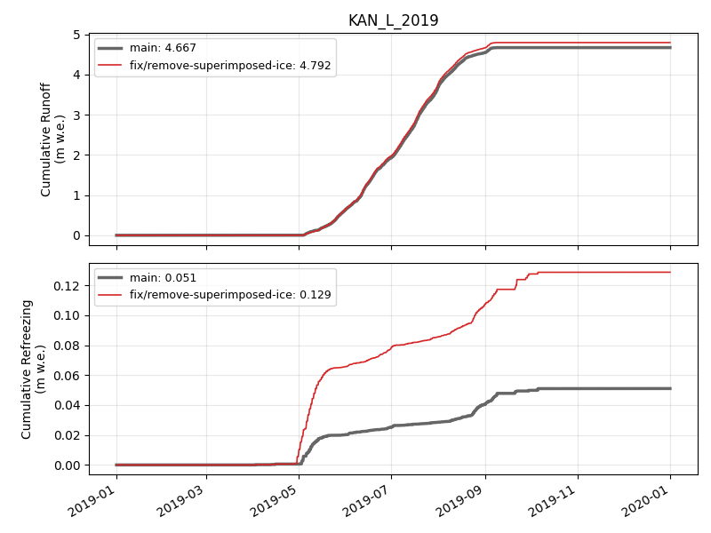

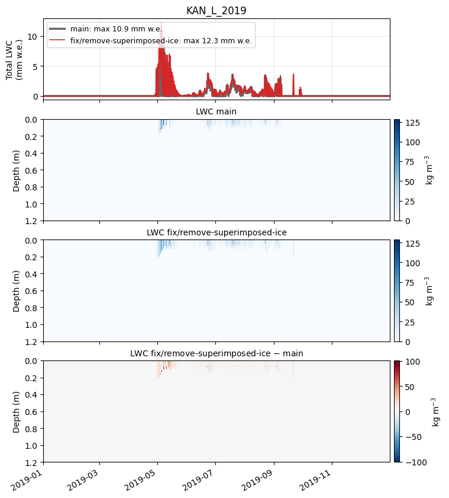

