## Changes

Fixes a double counting of shortwave (SW) radiation in `GEUS_model()` (`lib/seb_smb_model.py`).

### Problem on `main`

At each time step, `SRbalance()` distributed the net SW over all layers (Beer–Lambert extinction) and warmed `T_ice[:, k]` with it, top layer included. Then:
1. `GEUS_model()` summed the absorbed SW back into the top layer (`SRnet[0] = SRnet_tot`), so the surface energy budget received **all** the net SW;
2. but `SurfEnergyBudget()` computed the conductive flux with `T_ice[1]`, the temperature of the second layer **already warmed by the same SW**. The SW absorbed in layer 1 was therefore counted twice: at the surface, and as a reduced conductive heat loss from the surface. For bare ice with a net SW of ~300 W m⁻², layer 1 warms by ~5 K in a 3-hour step, which changes the conductive flux by tens of W m⁻² while the surface melts;
3. `tsoil_diffusion()` then recomputed all subsurface temperatures from the previous time step's coefficients, so the SW warming of the subsurface was discarded anyway.

### Change

All net SW is absorbed at the surface (`SRnet = [SRin - SRout, 0, ...]`), which is what `main` intended, and `T_ice` is no longer warmed before the surface energy budget (`T_ice[:, k] = T_ice[:, k - 1]`). `SRbalance()` is no longer called; shortwave penetration below the surface will be implemented properly, as an option, in a separate PR.

### Effect on the test runs

Removing the double counting reduces surface melt:
- **KAN_L**: −0.325 (2012) and −0.409 (2019) m w.e. (−7 to −8 %), with the same decrease in runoff; SMB +0.321 and +0.408 m w.e.
- **DY2**: −0.024 (2012) and −0.059 (2019) m w.e. (−4 % and −30 %), mostly compensated by less refreezing; SMB +0.001 and −0.008 m w.e.

## Effect on the test runs

Totals over each test case in m w.e. (fix/sw-double-count vs main). Constant Tdeep = 263 K, no spin-up (initial profiles from input/initial state).

| Test case | Variable | main | fix/sw-double-count | Difference | Difference (%) |
|---|---|---|---|---|---|
| DY2_2012 | Melt | 0.693 | 0.669 | -0.024 | -3.5 |
| DY2_2012 | Runoff | 0.041 | 0.034 | -0.007 | -16.0 |
| DY2_2012 | Refreezing | 0.693 | 0.676 | -0.017 | -2.5 |
| DY2_2012 | Sublimation | -0.006 | -0.000 | +0.005 | +91.8 |
| DY2_2012 | SMB | 0.552 | 0.553 | +0.001 | +0.2 |
| DY2_2019 | Melt | 0.197 | 0.137 | -0.059 | -30.1 |
| DY2_2019 | Runoff | 0.000 | 0.000 | +0.000 | n/a |
| DY2_2019 | Refreezing | 0.197 | 0.138 | -0.059 | -30.1 |
| DY2_2019 | Sublimation | 0.001 | 0.009 | +0.008 | +725.0 |
| DY2_2019 | SMB | 0.272 | 0.264 | -0.008 | -2.9 |
| KAN_L_2012 | Melt | 4.509 | 4.184 | -0.325 | -7.2 |
| KAN_L_2012 | Runoff | 4.554 | 4.229 | -0.325 | -7.1 |
| KAN_L_2012 | Refreezing | 0.187 | 0.187 | +0.000 | +0.2 |
| KAN_L_2012 | Sublimation | 0.045 | 0.049 | +0.004 | +8.8 |
| KAN_L_2012 | SMB | -4.070 | -3.749 | +0.321 | +7.9 |
| KAN_L_2019 | Melt | 4.869 | 4.460 | -0.409 | -8.4 |
| KAN_L_2019 | Runoff | 4.792 | 4.377 | -0.415 | -8.7 |
| KAN_L_2019 | Refreezing | 0.129 | 0.135 | +0.006 | +4.6 |
| KAN_L_2019 | Sublimation | -0.038 | -0.031 | +0.007 | +19.0 |
| KAN_L_2019 | SMB | -4.506 | -4.098 | +0.408 | +9.1 |

### DY2_2012

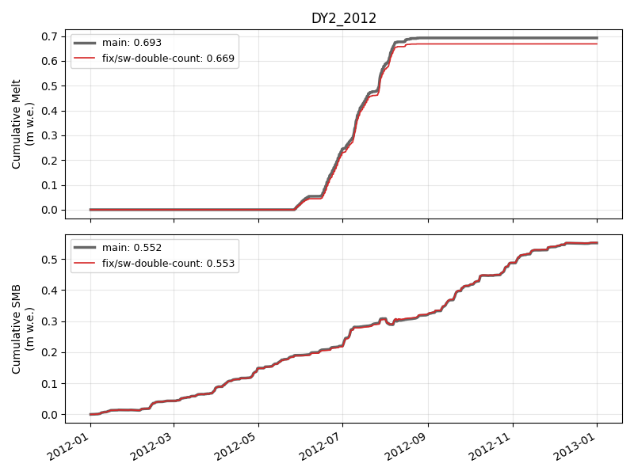

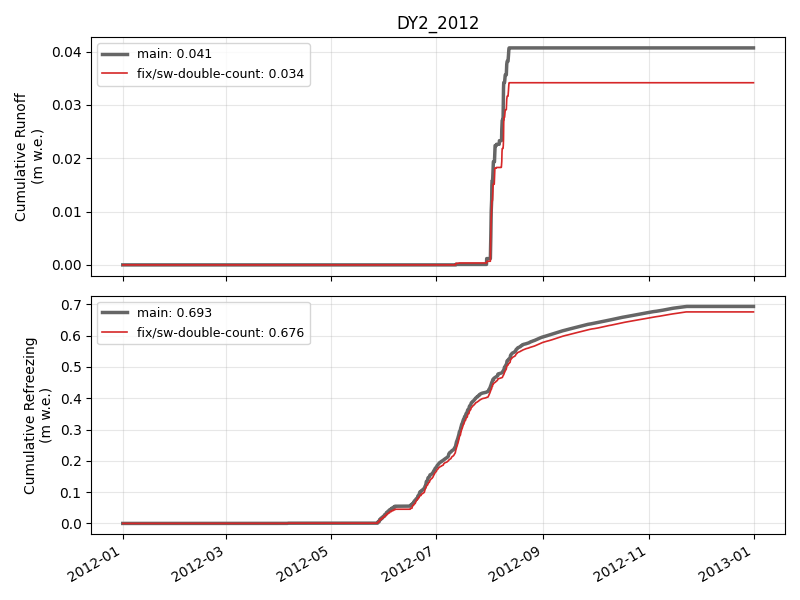

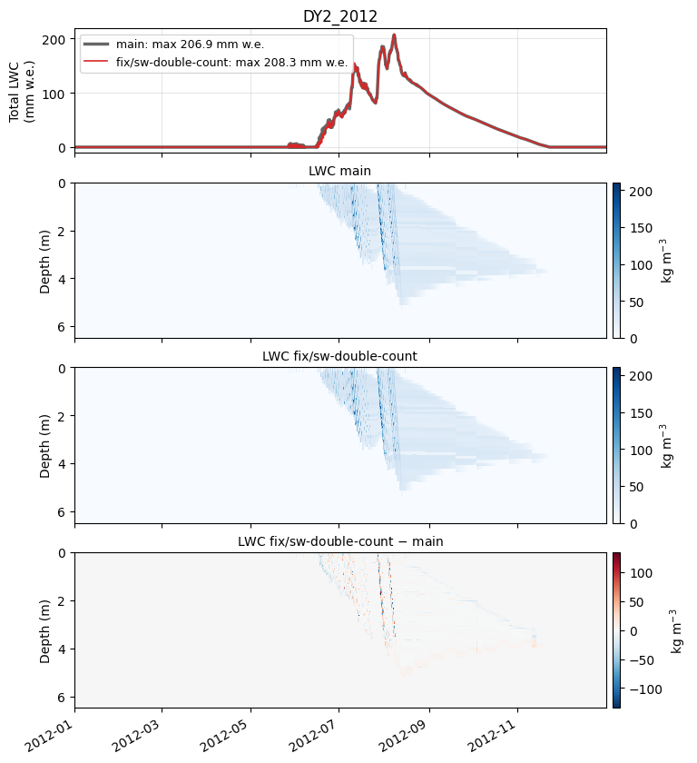

### DY2_2019

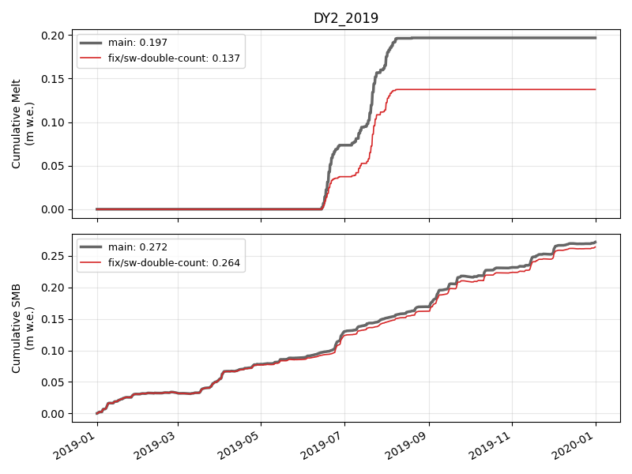

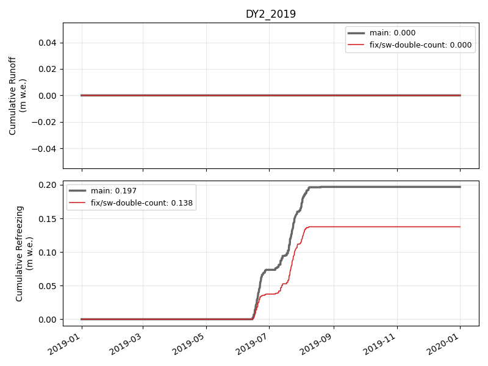

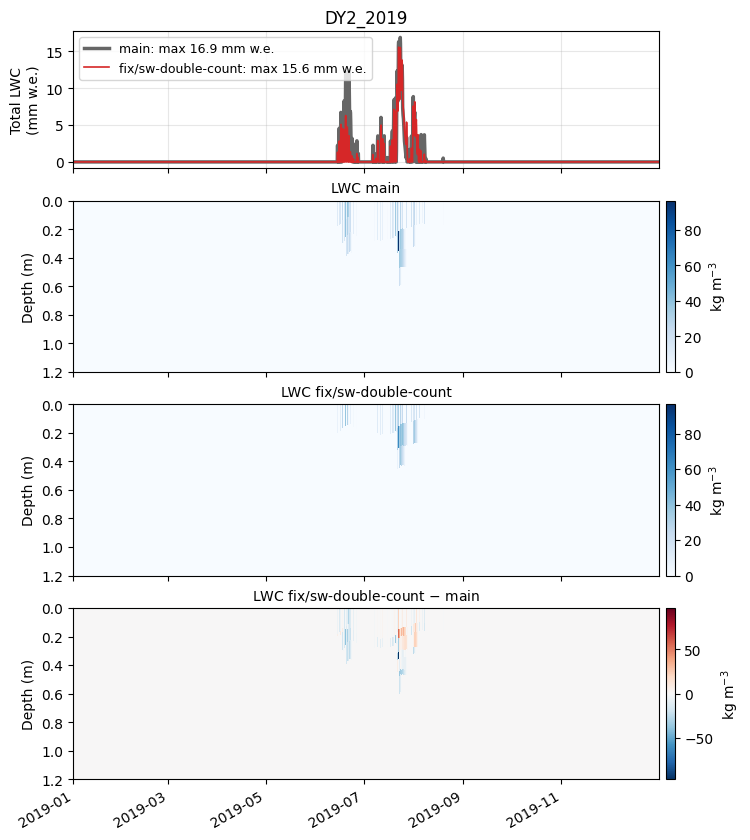

### KAN_L_2012

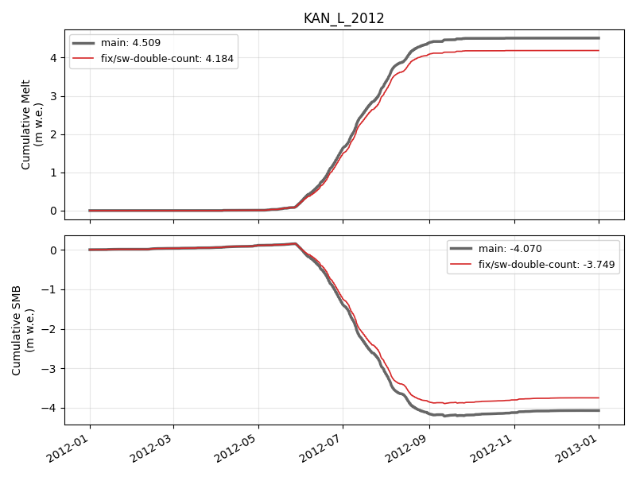

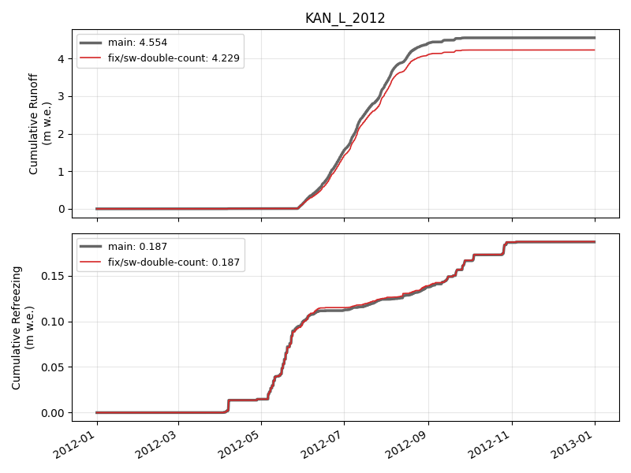

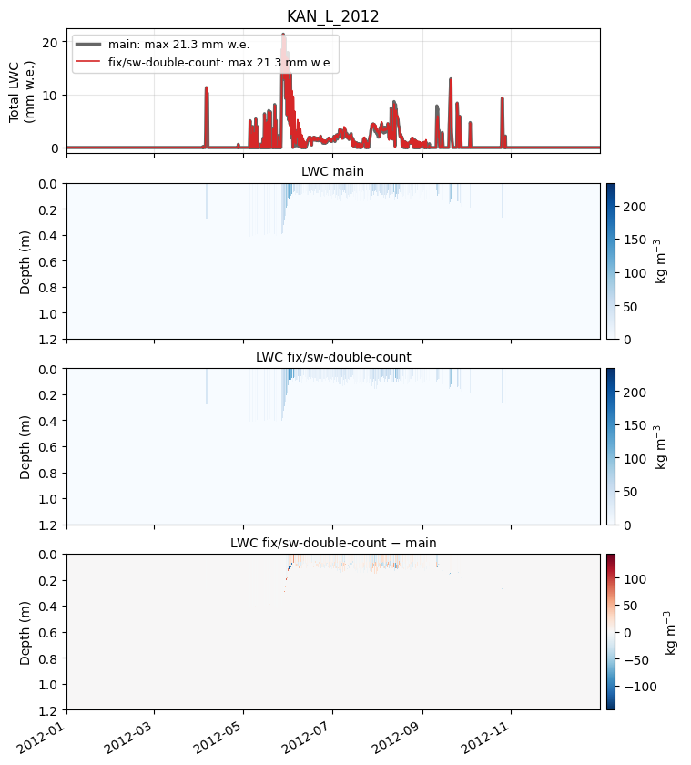

### KAN_L_2019

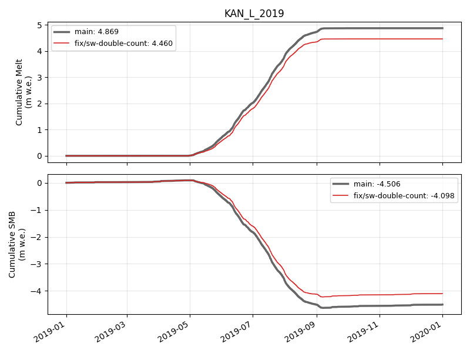

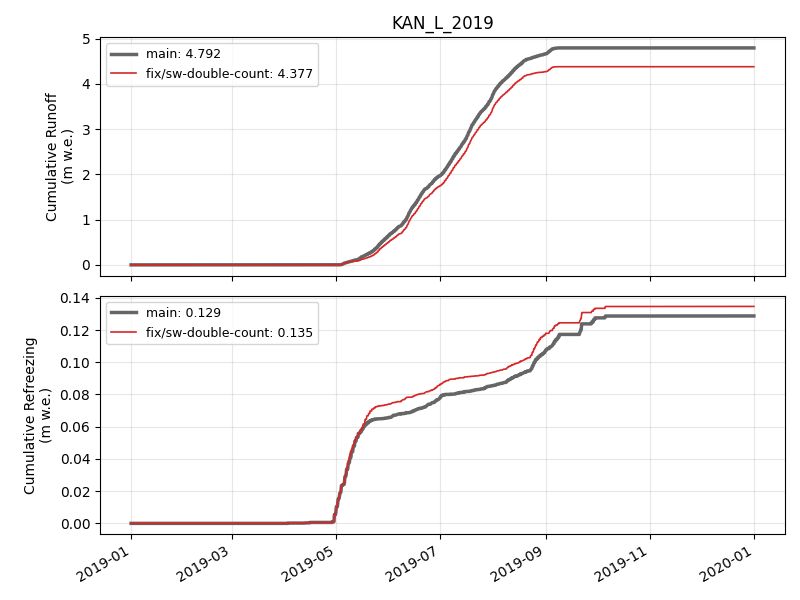

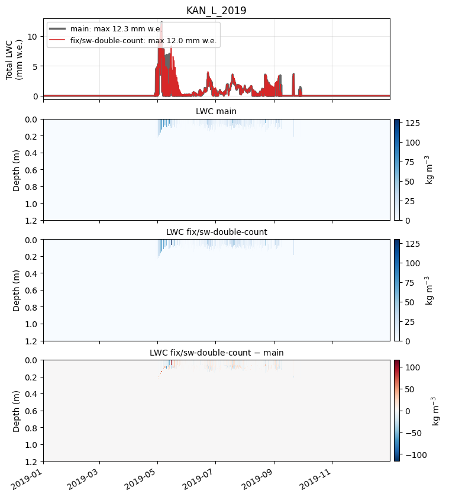

