## Changes

Adds an optional penetration of shortwave radiation below the top layer, switched by the new constant `sw_penetration` in `input/constants/const_sim.csv` (**default 0 = off**, all net shortwave absorbed at the surface as on main since #15).

With `sw_penetration = 1`:
- `SRbalance()` (rewritten) computes the downwelling shortwave flux at the top of each layer with Beer–Lambert extinction (`ext_snow` in the snowpack, `ext_ice` below). The surface energy budget gets what is absorbed in the top layer (`SRnet[0] - SRnet[1]`); what is absorbed in each deeper layer (`sw_absorbed`) is passed to the subsurface model. The bottom layer absorbs what is left, so energy is conserved.
- `SRbalance()` no longer changes `T_ice` itself (that was overwritten by the heat diffusion anyway and caused the double count fixed in #15).
- New `sw_heating()` in `lib/subsurface.py`, applied right after `tsoil_diffusion`: the absorbed energy first warms the frozen part of each layer to 0 °C, the rest melts snow and ice in proportion of their mass. The meltwater is added to `slwc` and then percolates, refreezes or runs off like any other water.
- New output `internal_melt_mweq` (melt below the top layer, m w.e.); `melt_mweq` is now described as surface melt. Both are needed to get the total melt.
- `compare_runs.py`: the summary table shows n/a for a variable that only one of the two runs has (here `internal_melt_mweq`) and leaves it out of the "identical" check.

### Are the test outputs unchanged with penetration switched off?

**Yes.** With the default `sw_penetration = 0`, melt, runoff, refreezing, sublimation and SMB are bit-identical to main over the full time series of the four test cases (checked with `np.array_equal`, not only the rounded totals), and the LWC profile differences are zero (figures below). `internal_melt_mweq` is 0 everywhere.

### Effect with `sw_penetration = 1` (for information, not the default)

Totals in m w.e., `sw_penetration = 1` vs main. "Total melt" = surface + internal melt.

| Test case | Surface melt | Internal melt | Total melt (main → on) | Runoff | Refreezing | SMB |
|---|---|---|---|---|---|---|
| DY2_2012 | 0.669 → 0.326 | 0.634 | 0.669 → 0.960 (×1.4) | +0.071 | +0.166 | −0.063 |
| DY2_2019 | 0.137 → 0.055 | 0.432 | 0.137 → 0.487 (×3.6) | +0.002 | +0.348 | +0.022 |
| KAN_L_2012 | 4.184 → 2.494 | 1.823 | 4.184 → 4.317 (+3 %) | +0.169 | −0.036 | −0.165 |
| KAN_L_2019 | 4.460 → 1.902 | 2.757 | 4.460 → 4.659 (+4 %) | +0.232 | −0.033 | −0.229 |

With `ext_snow = 20` and `ext_ice = 5` m⁻¹ a large part of the shortwave is absorbed below the top layer, where it melts snow and ice instead of balancing the surface energy budget, so the cold surface layer no longer limits melt. At DY2 this multiplies total melt by 1.4–3.6 (most of it refreezes), which looks too strong for the dry-snow / percolation zone; at KAN_L total melt increases by 3–4 %. The extinction coefficients (and the layer thickness of the top layer) would need to be evaluated before turning this on, so the default stays off.

## Effect on the test runs (default, `sw_penetration = 0`)

Totals over each test case in m w.e. (feature/sw-penetration vs main). Constant Tdeep = 263 K, no spin-up (initial profiles from input/initial state).

**All compared variables are identical.**

| Test case | Variable | main | feature/sw-penetration | Difference | Difference (%) |
|---|---|---|---|---|---|
| DY2_2012 | Melt | 0.669 | 0.669 | +0.000 | +0.0 |
| DY2_2012 | Internal melt | n/a | 0.000 | n/a | n/a |
| DY2_2012 | Runoff | 0.034 | 0.034 | +0.000 | +0.0 |
| DY2_2012 | Refreezing | 0.676 | 0.676 | +0.000 | +0.0 |
| DY2_2012 | Sublimation | -0.000 | -0.000 | +0.000 | +0.0 |
| DY2_2012 | SMB | 0.553 | 0.553 | +0.000 | +0.0 |
| DY2_2019 | Melt | 0.137 | 0.137 | +0.000 | +0.0 |
| DY2_2019 | Internal melt | n/a | 0.000 | n/a | n/a |
| DY2_2019 | Runoff | 0.000 | 0.000 | +0.000 | n/a |
| DY2_2019 | Refreezing | 0.138 | 0.138 | +0.000 | +0.0 |
| DY2_2019 | Sublimation | 0.009 | 0.009 | +0.000 | +0.0 |
| DY2_2019 | SMB | 0.264 | 0.264 | +0.000 | +0.0 |
| KAN_L_2012 | Melt | 4.184 | 4.184 | +0.000 | +0.0 |
| KAN_L_2012 | Internal melt | n/a | 0.000 | n/a | n/a |
| KAN_L_2012 | Runoff | 4.229 | 4.229 | +0.000 | +0.0 |
| KAN_L_2012 | Refreezing | 0.187 | 0.187 | +0.000 | +0.0 |
| KAN_L_2012 | Sublimation | 0.049 | 0.049 | +0.000 | +0.0 |
| KAN_L_2012 | SMB | -3.749 | -3.749 | +0.000 | +0.0 |
| KAN_L_2019 | Melt | 4.460 | 4.460 | +0.000 | +0.0 |
| KAN_L_2019 | Internal melt | n/a | 0.000 | n/a | n/a |
| KAN_L_2019 | Runoff | 4.377 | 4.377 | +0.000 | +0.0 |
| KAN_L_2019 | Refreezing | 0.135 | 0.135 | +0.000 | +0.0 |
| KAN_L_2019 | Sublimation | -0.031 | -0.031 | +0.000 | +0.0 |
| KAN_L_2019 | SMB | -4.098 | -4.098 | +0.000 | +0.0 |

### DY2_2012

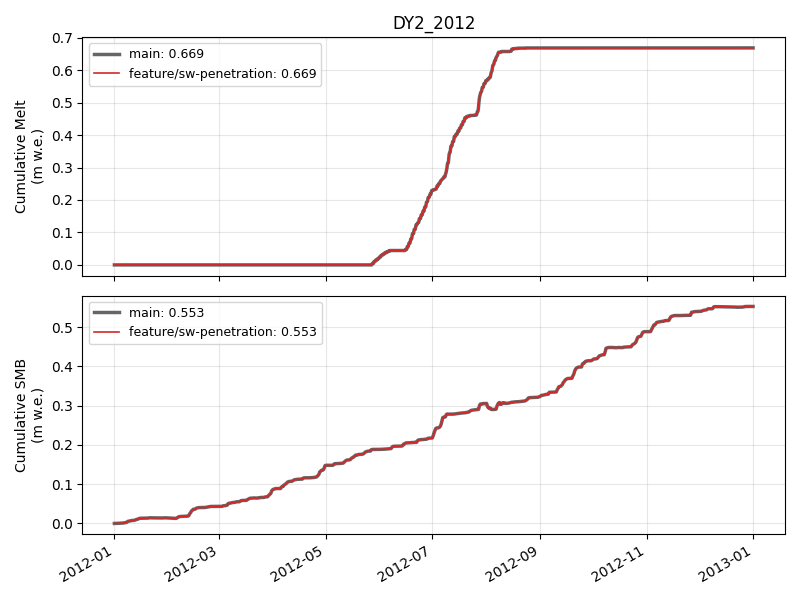

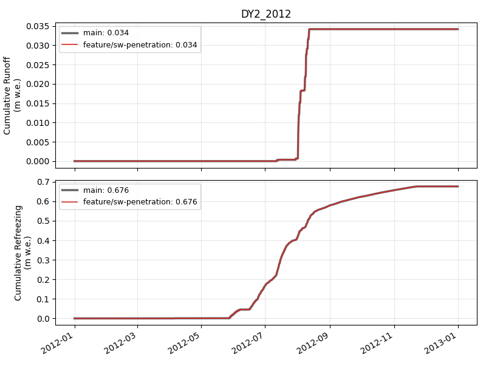

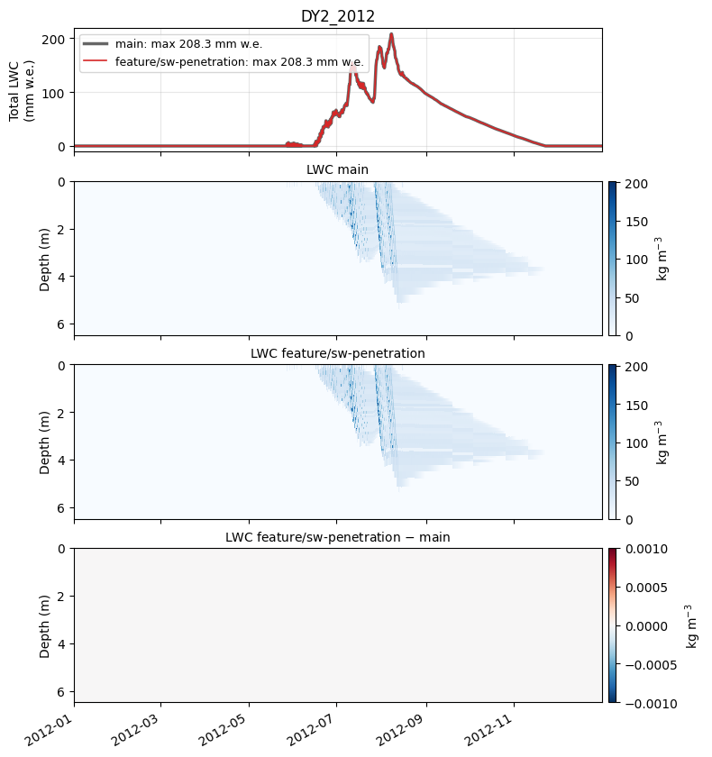

### DY2_2019

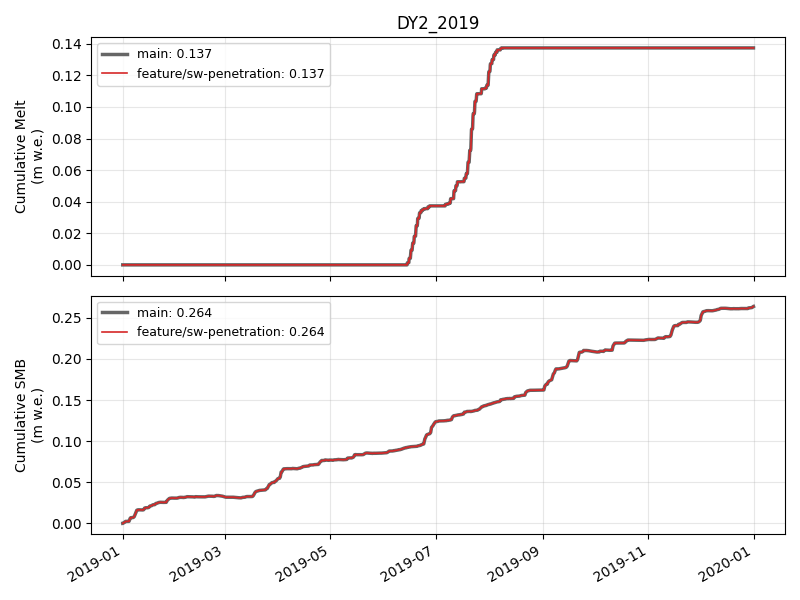

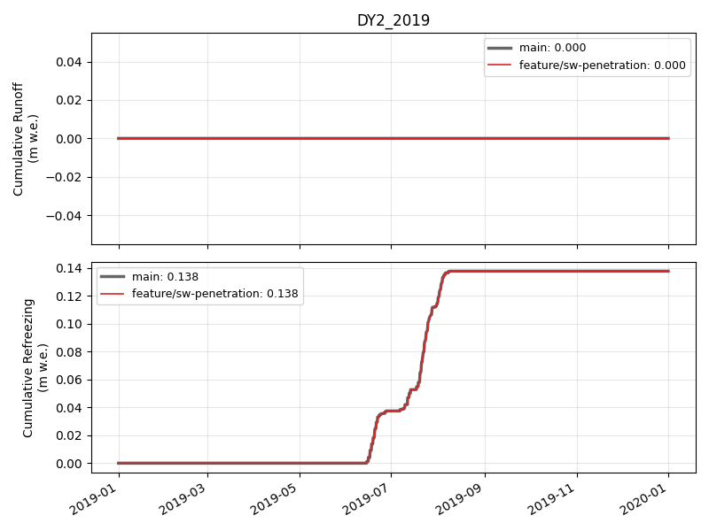

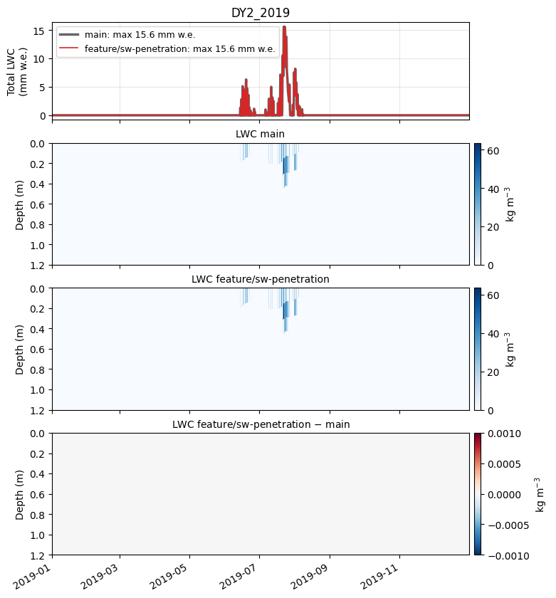

### KAN_L_2012

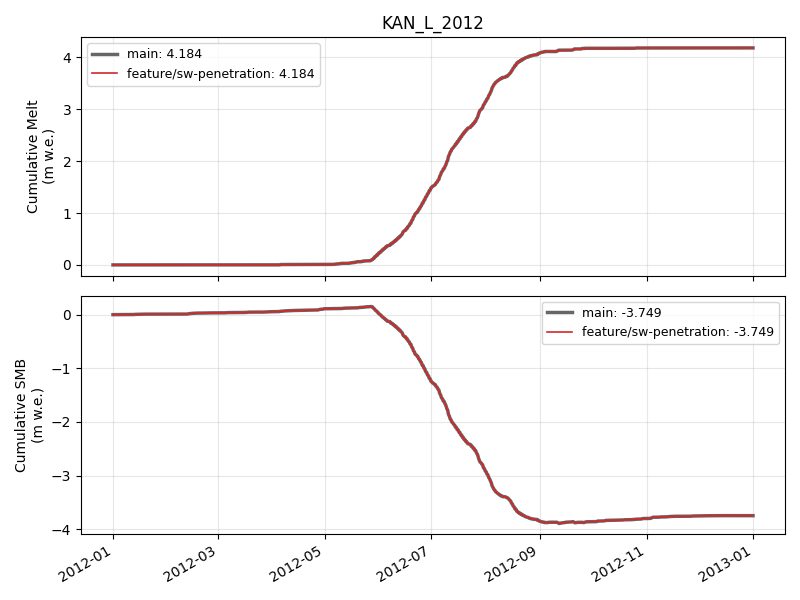

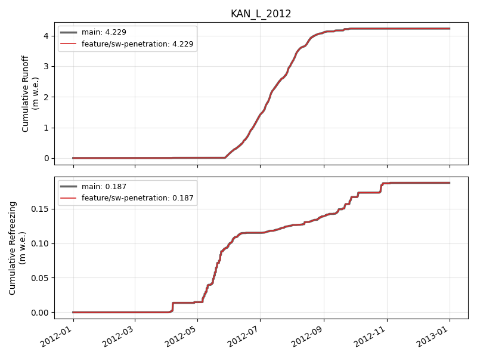

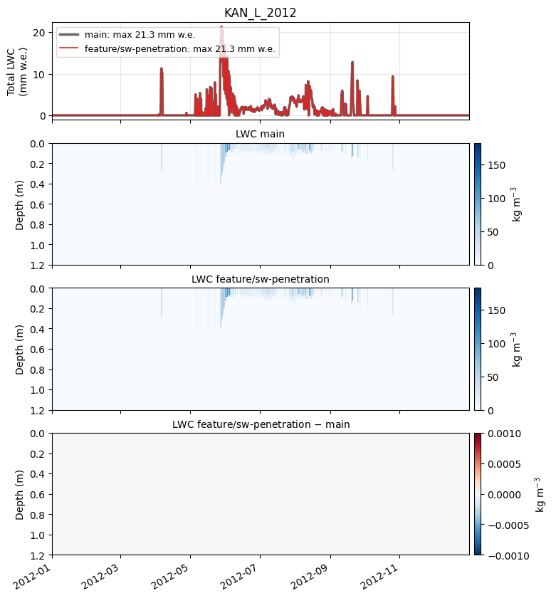

### KAN_L_2019

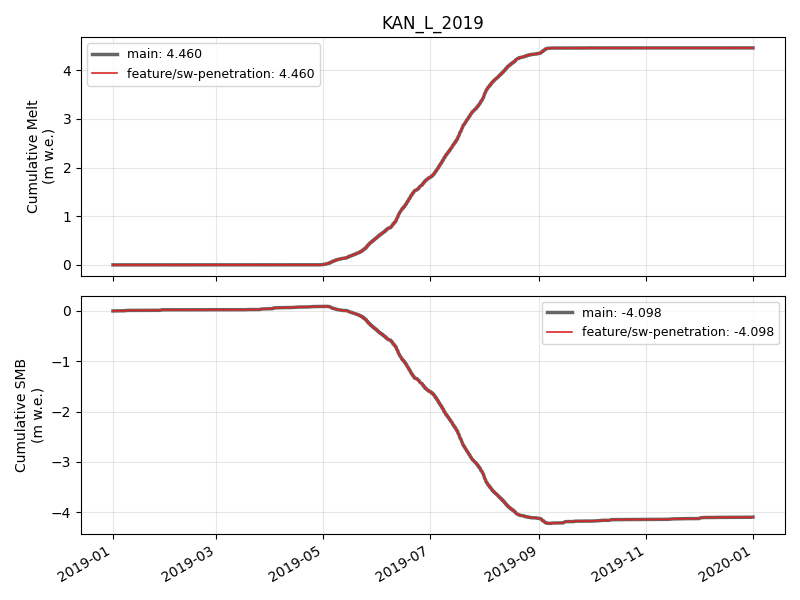

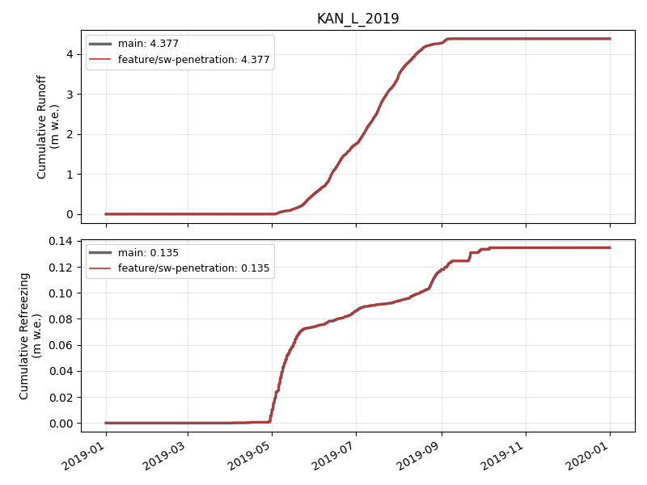

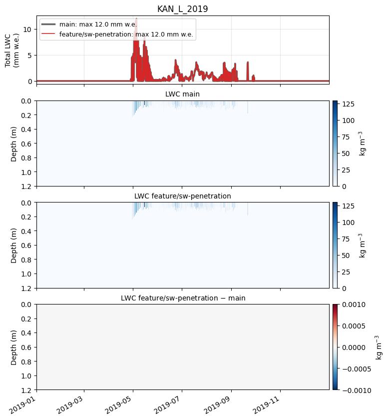

🤖 Generated with [Claude Code](https://claude.com/claude-code)
