## Changes

Three fixes in the turbulent heat flux calculation (`SensLatFluxes_bulk_opt` in `lib/seb_smb_model.py`), from bav-dev:

**1. 2 m temperature / humidity and 10 m wind speed (output diagnostics only)**
- Stable conditions: `theta_2m`, `q_2m` and `ws_10m` were never computed ("will be updated later") and stayed equal to the values at sensor height. They are now computed from the stability-corrected profiles, as in unstable conditions.
- Unstable conditions: the stability corrections were evaluated at the sensor heights (`psi_h2`, `psi_q2`, `psi_m2`) instead of at 2 m and 10 m. They are now evaluated at 2 m and 10 m.
- The corrections use the Monin–Obukhov length that was used for u\*, θ\* and q\* in the last iteration, so the profiles go exactly through the measurements at sensor height. bav-dev used the length updated after the last flux calculation. In very stable conditions that length can be ≤ 0 or close to 0, and on the test cases it gave 2 m temperatures up to 420 K.
- `theta_2m` is now the actual temperature at 2 m, as described in `output_variables_info.csv`, instead of the potential temperature (−2g/c_pd = −0.02 K).

**2. Latent heat on a melting surface.** The latent heat flux and `sublimation_mweq` used the latent heat of sublimation at all times. When the surface is melting (`Tsurf ≥ T_0`), the moisture is exchanged with liquid water, so the latent heat of vaporization is used instead (new `latent_heat()`). The same LHF then moves 12 % less energy per kg (2.50 vs 2.83 MJ kg⁻¹).

**3. Monin–Obukhov length** (`get_L`)
- The water-vapour buoyancy term was θ\*(1 + βq\*) instead of θ\* + βθq\* (with β ≈ 0.608), so the moisture flux had almost no effect on stability.
- In stable conditions the iteration now stops when L ≤ 0 (it used to stop when L < 1e-12, which is the same in practice).
- Removed a second calculation of q\* that repeated `get_th_star_q_star`. It gave the same value, so this has no effect.

### Effect, by change
- **Diagnostics (1):** no effect on the mass balance; the diagnostics are not used anywhere else in the model. On the test cases, `q_2m` and `ws_10m` are unchanged and `theta_2m` is lower by exactly 0.02 K (potential → actual). The test forcing is CARRA, already at 2 m and 10 m, so the profile evaluated at 2 m and 10 m returns the input. A synthetic check with sensors at 1.2–3.5 m shows that the profiles go through the measurements and give 2 m and 10 m values between the surface and sensor values, or extend the profile beyond the sensor.
- **Monin–Obukhov length (3):** small; melt changes by ≤ 0.007 m w.e. (run with change 2 switched off).
- **Latent heat (2):** most of the difference. When there is condensation onto a melting surface (LHF > 0), less energy reaches the surface, so melt decreases (KAN_L_2012: −0.06 m w.e.). When there is evaporation from it (LHF < 0), less energy is lost, so melt increases (DY2_2019: +0.015 m w.e., which all refreezes). At KAN_L_2019 the two cancel out.

## Effect on the test runs

Totals over each test case in m w.e. (fix/turbulent-fluxes vs main). Constant Tdeep = 263 K, no spin-up (initial profiles from input/initial state).

| Test case | Variable | main | fix/turbulent-fluxes | Difference | Difference (%) |
|---|---|---|---|---|---|
| DY2_2012 | Melt | 0.669 | 0.671 | +0.002 | +0.3 |
| DY2_2012 | Internal melt | 0.000 | 0.000 | +0.000 | n/a |
| DY2_2012 | Runoff | 0.034 | 0.029 | -0.005 | -14.5 |
| DY2_2012 | Refreezing | 0.676 | 0.683 | +0.007 | +1.0 |
| DY2_2012 | Sublimation | -0.000 | -0.001 | -0.000 | -9.6 |
| DY2_2012 | SMB | 0.553 | 0.558 | +0.005 | +0.9 |
| DY2_2019 | Melt | 0.137 | 0.153 | +0.015 | +11.1 |
| DY2_2019 | Internal melt | 0.000 | 0.000 | +0.000 | n/a |
| DY2_2019 | Runoff | 0.000 | 0.000 | +0.000 | n/a |
| DY2_2019 | Refreezing | 0.138 | 0.153 | +0.015 | +11.1 |
| DY2_2019 | Sublimation | 0.009 | 0.008 | -0.001 | -11.6 |
| DY2_2019 | SMB | 0.264 | 0.265 | +0.001 | +0.4 |
| KAN_L_2012 | Melt | 4.184 | 4.119 | -0.065 | -1.6 |
| KAN_L_2012 | Internal melt | 0.000 | 0.000 | +0.000 | n/a |
| KAN_L_2012 | Runoff | 4.229 | 4.159 | -0.070 | -1.6 |
| KAN_L_2012 | Refreezing | 0.187 | 0.192 | +0.005 | +2.6 |
| KAN_L_2012 | Sublimation | 0.049 | 0.049 | -0.001 | -1.5 |
| KAN_L_2012 | SMB | -3.749 | -3.679 | +0.070 | +1.9 |
| KAN_L_2019 | Melt | 4.460 | 4.455 | -0.005 | -0.1 |
| KAN_L_2019 | Internal melt | 0.000 | 0.000 | +0.000 | n/a |
| KAN_L_2019 | Runoff | 4.377 | 4.368 | -0.009 | -0.2 |
| KAN_L_2019 | Refreezing | 0.135 | 0.138 | +0.003 | +2.6 |
| KAN_L_2019 | Sublimation | -0.031 | -0.032 | -0.001 | -4.8 |
| KAN_L_2019 | SMB | -4.098 | -4.088 | +0.010 | +0.2 |

### DY2_2012

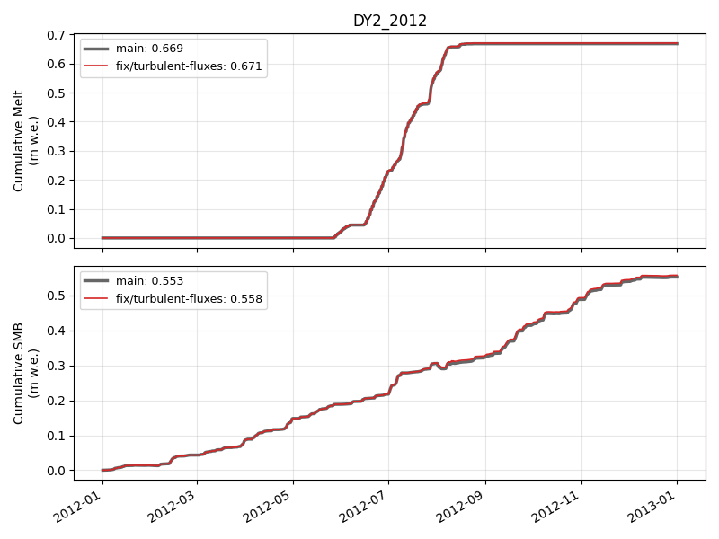

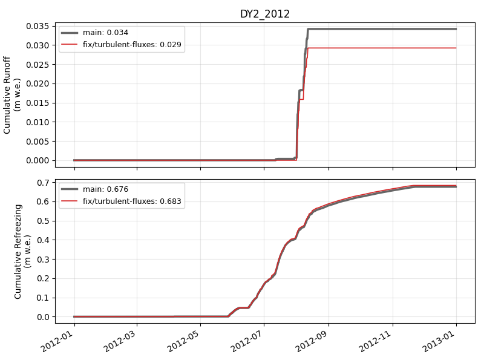

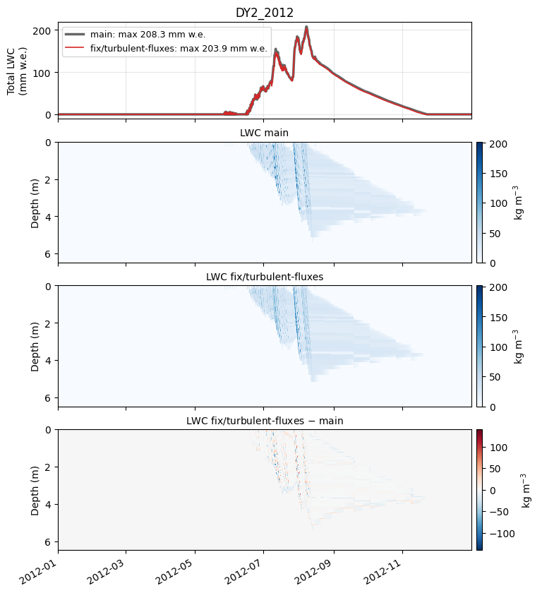

### DY2_2019

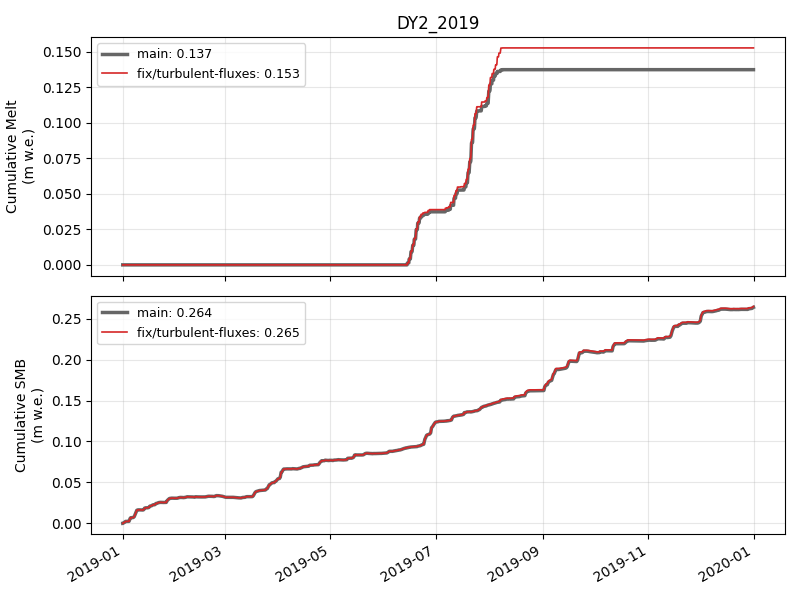

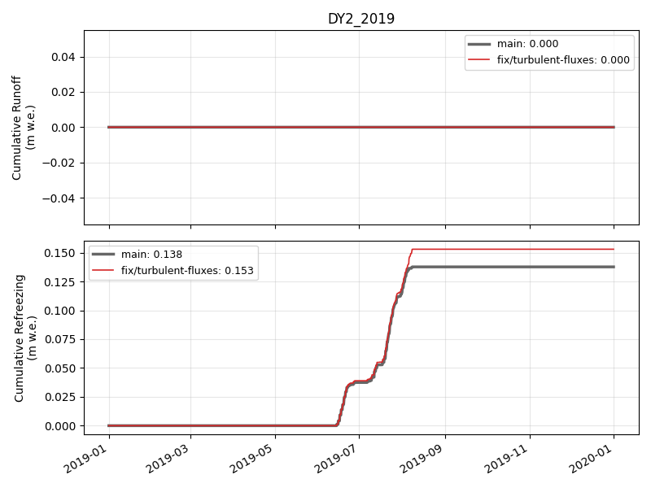

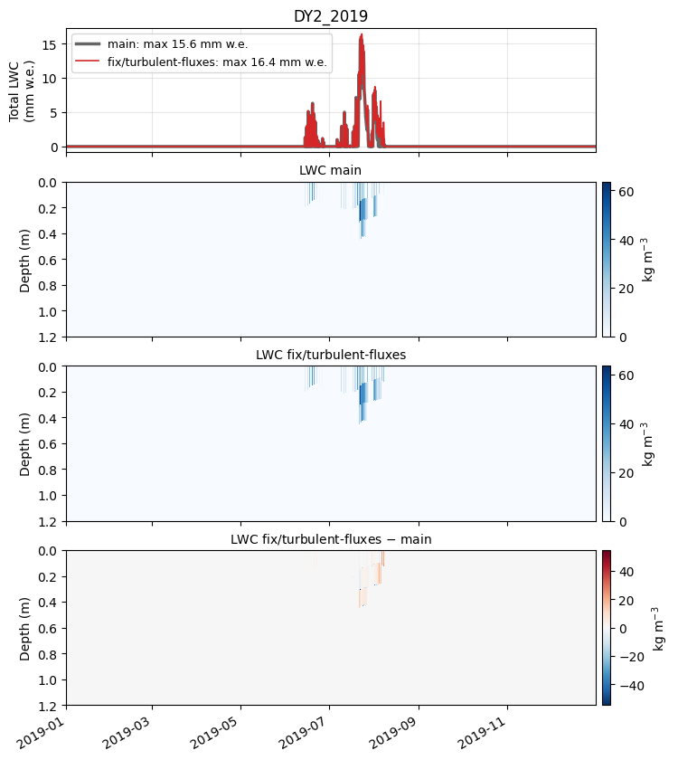

### KAN_L_2012

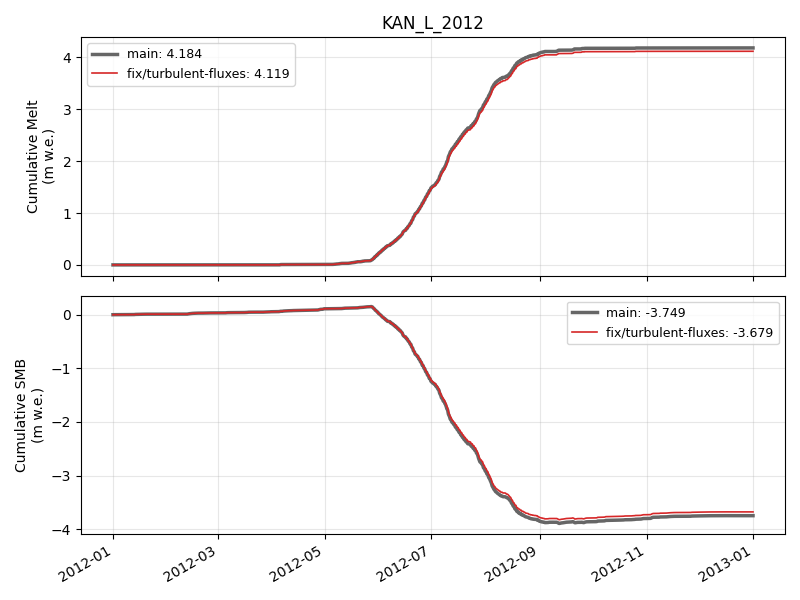

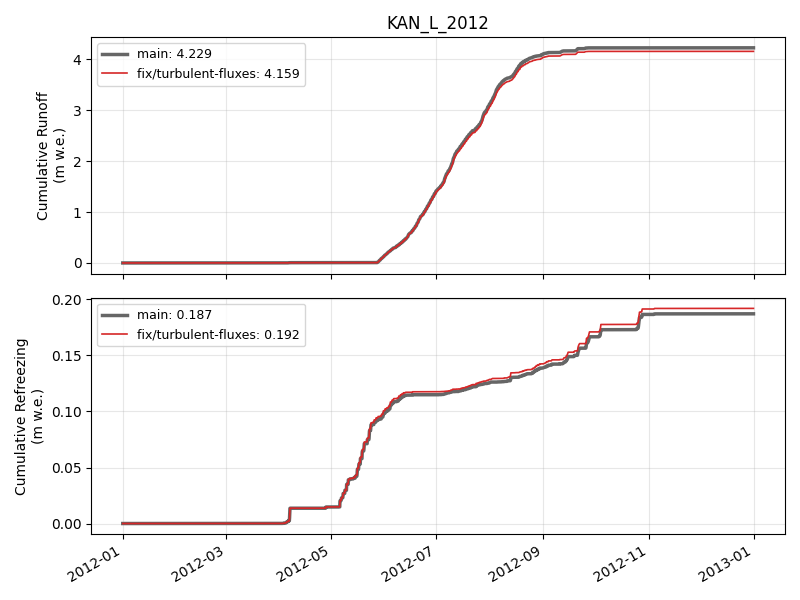

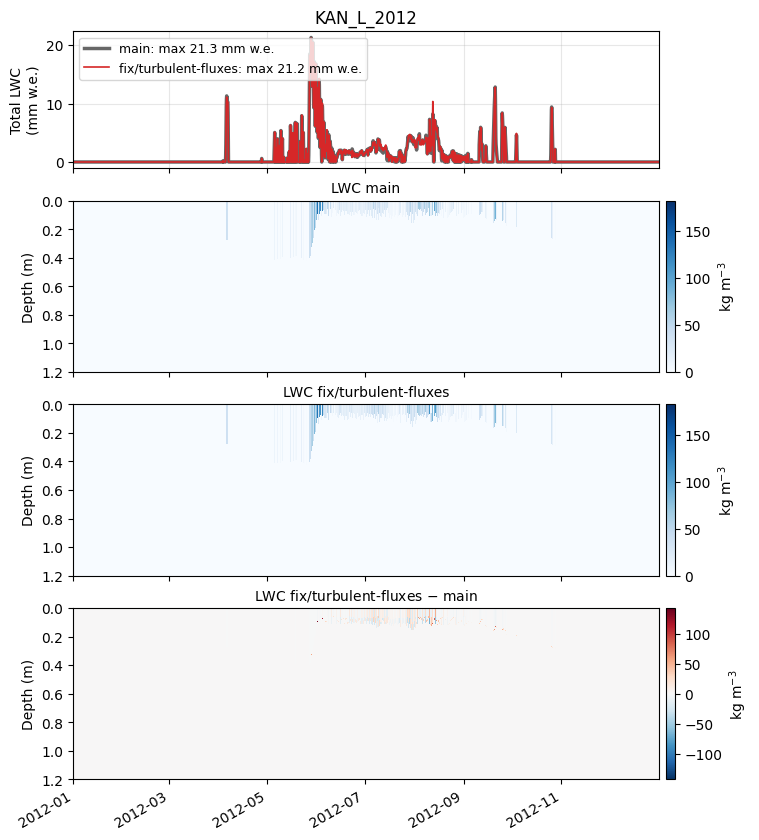

### KAN_L_2019

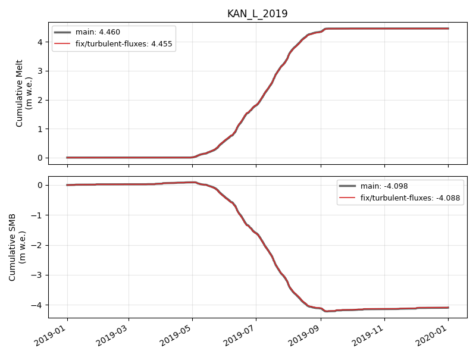

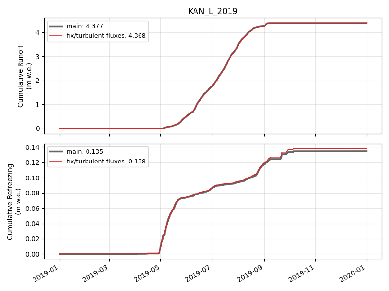

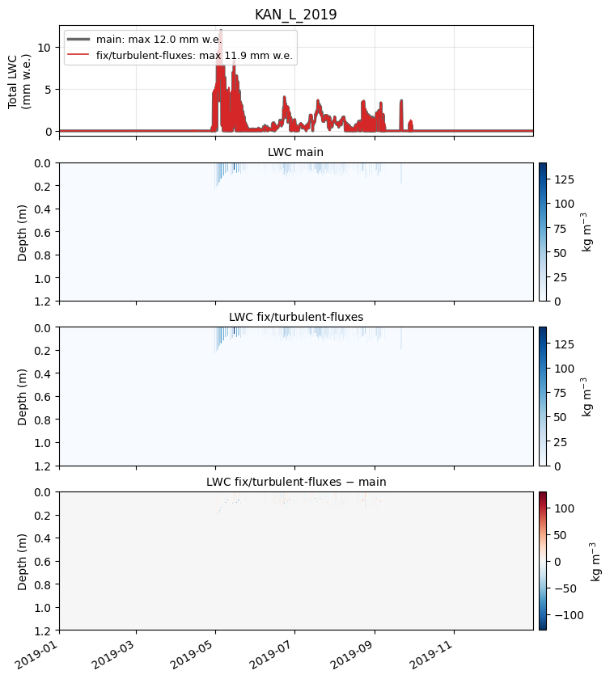

🤖 Generated with [Claude Code](https://claude.com/claude-code)
