## Changes

### Problem on main: the surface and the subsurface do not exchange the same energy
The scheme on main comes from HIRHAM: layer 0 is set to the surface temperature (`ptsoil[0] = Tsurf` in `tsoil_diffusion`). In HIRHAM, the surface temperature is solved with the heat capacity and flux of that node (`pgrndcapc`, `pgrndhflx`), so the two are consistent. These are still computed here, but the Python surface energy budget does not use them. It uses its own conduction flux, `k_eff[0]·(Tsurf − T_ice[1]) / thick_first_lay`, which does not match the subsurface:
- it uses Anderson's conductivity, while the diffusion uses Yen;
- `thick_first_lay` is the thickness of layer 0 in **m w.e.** instead of metres;
- it uses the temperature of layer 1, and it ignores the heat needed to bring layer 0 to Tsurf.

Measured on the test runs, per 3 h step: the conduction flux the SEB subtracts vs the heat the column gains in the diffusion step.

| Run | Mean \|mismatch\| | Correlation SEB flux vs column heat gain | Net mismatch, mean over the year |
|---|---|---|---|
| main, DY2_2012 | 20.7 W m⁻² | 0.58 | +4.7 W m⁻² |
| this PR, DY2_2012 | 1.5 W m⁻² | 1.00 | +1.3 W m⁻² |
| main, KAN_L_2019 | 15.8 W m⁻² | 0.79 | −2.2 W m⁻² |
| this PR, KAN_L_2019 | 2.0 W m⁻² | 1.00 | −1.8 W m⁻² |

The rows for this PR show the accuracy of the check itself: the heat exchanged at the bottom of the column, and heat capacities approximated as c_p × mass. So on main:
- the surface and the subsurface exchanged clearly different fluxes at each step;
- over the year the net imbalance is small (about 3 W m⁻² at DY2, 0.4 W m⁻² at KAN_L), because the errors mostly cancel between day and night.

### Change: skin-layer top boundary (from bav-dev), with the matching surface flux
- **Skin layer.** The surface temperature is now a skin temperature with no heat capacity, at the top of layer 0. Layer 0 is a normal layer with its node at its centre, coupled to the skin through the upper half of the layer: conductance `grndk = k₀ / (0.5 dz₀)`, with k₀ the harmonic-mean conductivity of the snow and ice of layer 0. It is solved implicitly with the rest of the column, so `T₀ = grndc[0] + grndd[0]·Tsurf` (`update_tempdiff_params_opt`, `tsoil_diffusion`).
- **Matching surface flux (not in bav-dev).** `SurfEnergyBudget` now uses exactly the flux that layer 0 receives, `G = grndk·((1 − grndd[0])·Tsurf − grndc[0])`, computed with the coefficients of the previous step, which are the ones the diffusion step uses. bav-dev changed the subsurface but kept the old surface flux, so the two still did not match.
- **Surface temperature output.** `subsurface_opt` now returns the surface skin temperature instead of `ptsoil[0]`.

Checked on a random 30-layer column:
- the solver matches a direct solve of the implicit system (max difference 3·10⁻¹³ K);
- the flux used by the surface energy budget (52.6123 W m⁻²) equals the heat gained by the column plus the heat lost at the bottom (52.6123 W m⁻²).

### Not included from bav-dev: liquid water in the heat diffusion
bav-dev also added the liquid water to the layer thickness, the heat capacity and the conductivity (water as a resistance in series, 0.56 W m⁻¹ K⁻¹). This is left out:
- the water fills the pore space, so it does not add to the thickness;
- in series it lowers the conductivity, whereas water in the pores raises it compared with air;
- layers containing water are at 0 °C, where `refreeze()` handles the latent heat, so the sensible heat of the water hardly matters.

### Extra bug fix: NaN in the turbulent fluxes (from #17)
With the corrected Monin–Obukhov length, L can be positive in the unstable branch: θ < Tsurf, but q > q_surf (condensation) makes the virtual-temperature flux stable. The next iteration then took (1 − γz/L)^¼ of a negative number, and the NaN spread to the whole column (DY2_2019, 22 July 2019). The unstable loop now stops when L ≥ 0, as the stable loop stops when L ≤ 0. This did not occur on main's test runs, so it changes nothing there.

### Effect
The surface is now colder in winter (−0.6 to −1.7 K in DJF) and melts more often in summer. Melt increases:
- KAN_L: +0.26 to +0.37 m w.e. (+6 to +9 %), with less refreezing and SMB −0.2 to −0.3 m w.e.;
- DY2: +0.06 and +0.08 m w.e.; at DY2_2019 most of the extra melt refreezes.

At KAN_L the net yearly imbalance on main was small (about 0.4 W m⁻²). So the change in melt there comes mainly from the timing of the heat exchange between the surface and the subsurface (day and night, and during melt), not from removing a net source or sink of energy.

The surface conductance now follows the subsurface model. Compared with main's surface flux, the median is 3.2 vs 5.4 W m⁻² K⁻¹ at DY2_2012 and 37 vs 23 W m⁻² K⁻¹ at KAN_L_2019.

## Effect on the test runs

Totals over each test case in m w.e. (fix/heat-diffusion vs main). Constant Tdeep = 263 K, no spin-up (initial profiles from input/initial state).

| Test case | Variable | main | fix/heat-diffusion | Difference | Difference (%) |
|---|---|---|---|---|---|
| DY2_2012 | Melt | 0.671 | 0.727 | +0.057 | +8.4 |
| DY2_2012 | Internal melt | 0.000 | 0.000 | +0.000 | n/a |
| DY2_2012 | Runoff | 0.010 | 0.034 | +0.025 | +256.3 |
| DY2_2012 | Refreezing | 0.703 | 0.714 | +0.011 | +1.5 |
| DY2_2012 | Sublimation | -0.001 | -0.005 | -0.005 | -802.5 |
| DY2_2012 | SMB | 0.577 | 0.557 | -0.020 | -3.5 |
| DY2_2019 | Melt | 0.153 | 0.234 | +0.081 | +53.2 |
| DY2_2019 | Internal melt | 0.000 | 0.000 | +0.000 | n/a |
| DY2_2019 | Runoff | 0.000 | 0.000 | +0.000 | n/a |
| DY2_2019 | Refreezing | 0.153 | 0.217 | +0.064 | +42.2 |
| DY2_2019 | Sublimation | 0.008 | -0.004 | -0.012 | -150.4 |
| DY2_2019 | SMB | 0.265 | 0.277 | +0.012 | +4.5 |
| KAN_L_2012 | Melt | 4.070 | 4.443 | +0.373 | +9.2 |
| KAN_L_2012 | Internal melt | 0.000 | 0.000 | +0.000 | n/a |
| KAN_L_2012 | Runoff | 4.063 | 4.373 | +0.310 | +7.6 |
| KAN_L_2012 | Refreezing | 0.239 | 0.183 | -0.056 | -23.3 |
| KAN_L_2012 | Sublimation | 0.049 | 0.041 | -0.008 | -15.8 |
| KAN_L_2012 | SMB | -3.583 | -3.885 | -0.302 | -8.4 |
| KAN_L_2019 | Melt | 4.423 | 4.684 | +0.262 | +5.9 |
| KAN_L_2019 | Internal melt | 0.000 | 0.000 | +0.000 | n/a |
| KAN_L_2019 | Runoff | 4.289 | 4.502 | +0.212 | +4.9 |
| KAN_L_2019 | Refreezing | 0.185 | 0.130 | -0.056 | -30.0 |
| KAN_L_2019 | Sublimation | -0.031 | -0.035 | -0.004 | -11.5 |
| KAN_L_2019 | SMB | -4.010 | -4.218 | -0.209 | -5.2 |

### DY2_2012

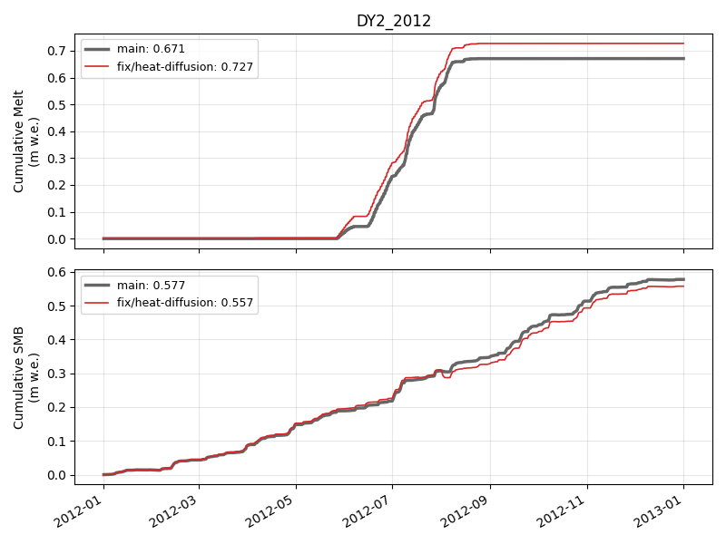

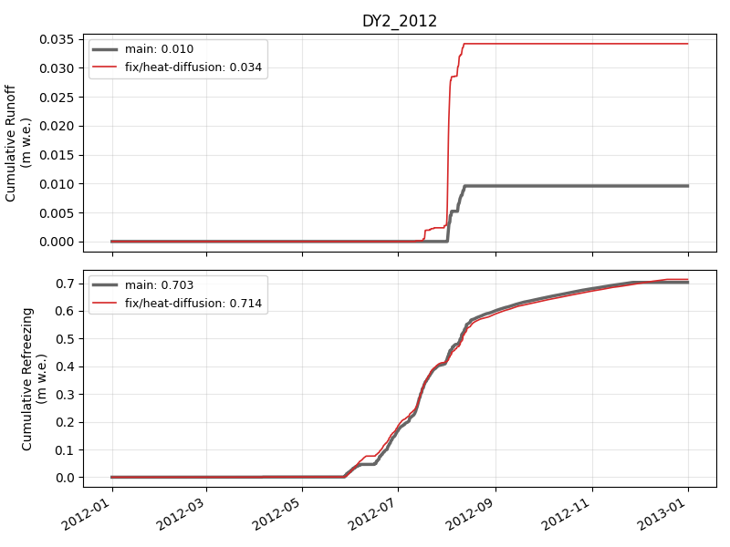

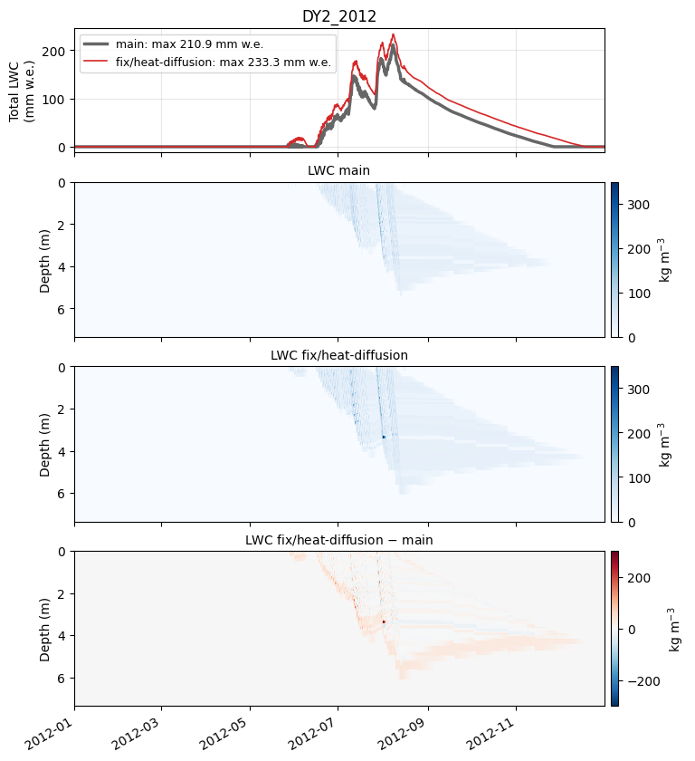

### DY2_2019

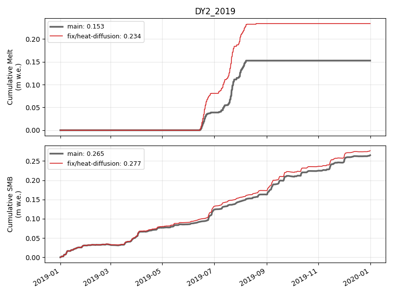

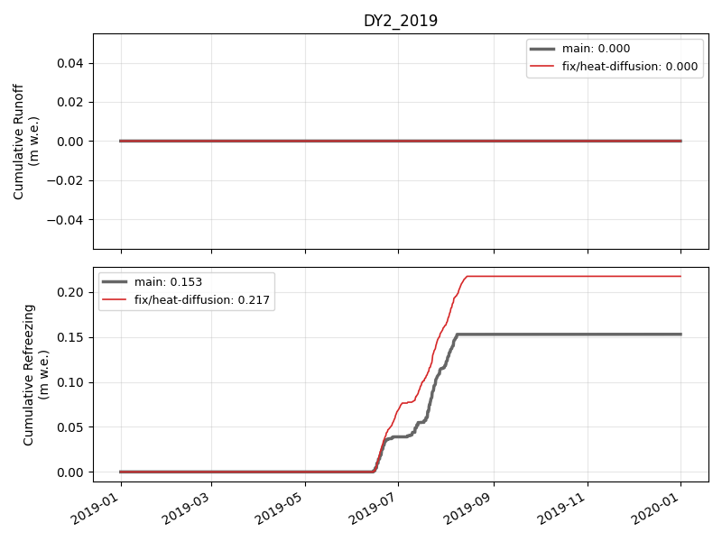

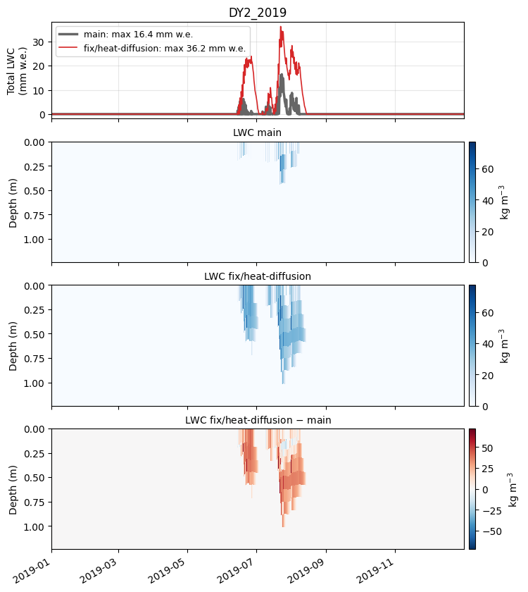

### KAN_L_2012

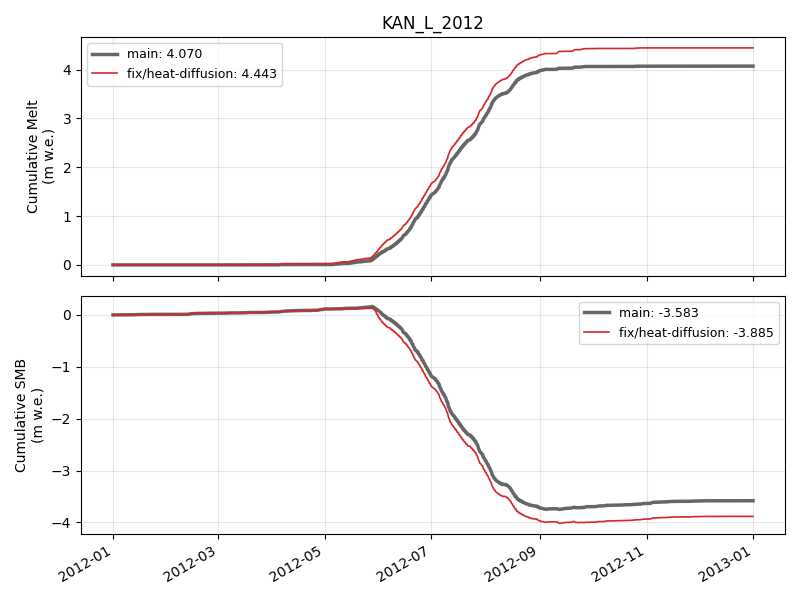

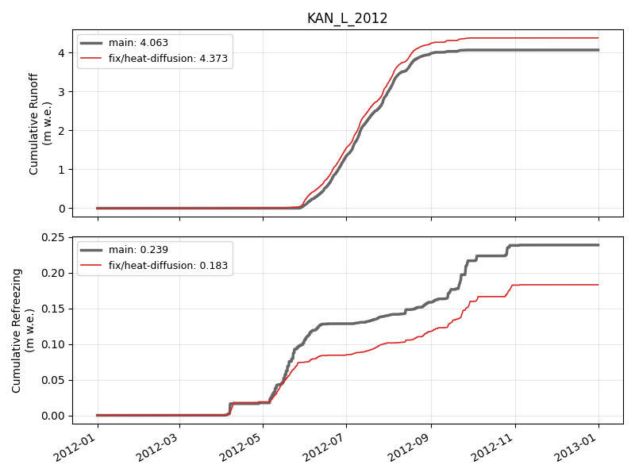

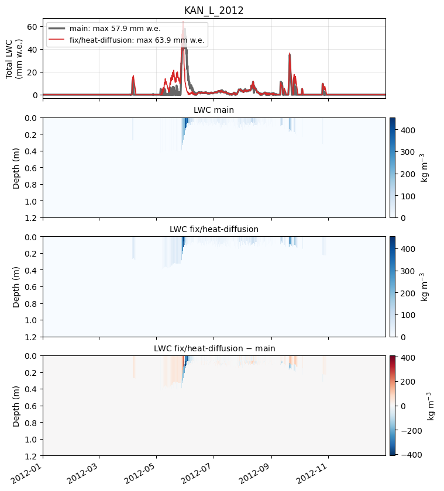

### KAN_L_2019

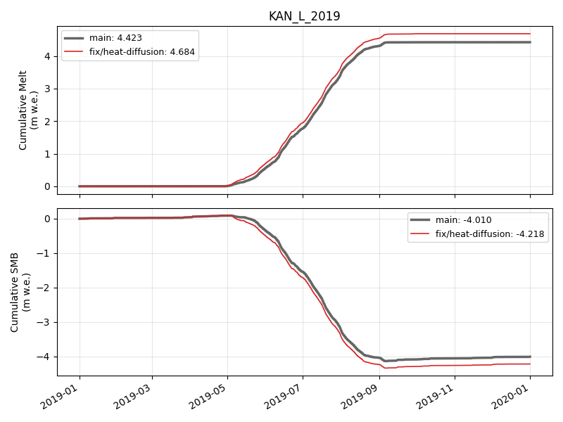

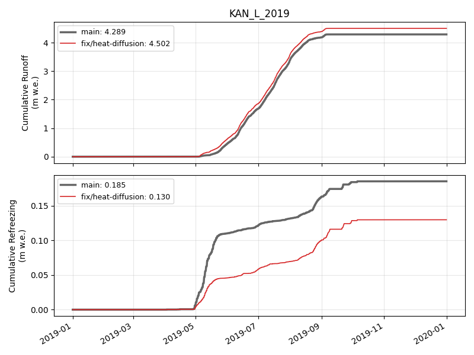

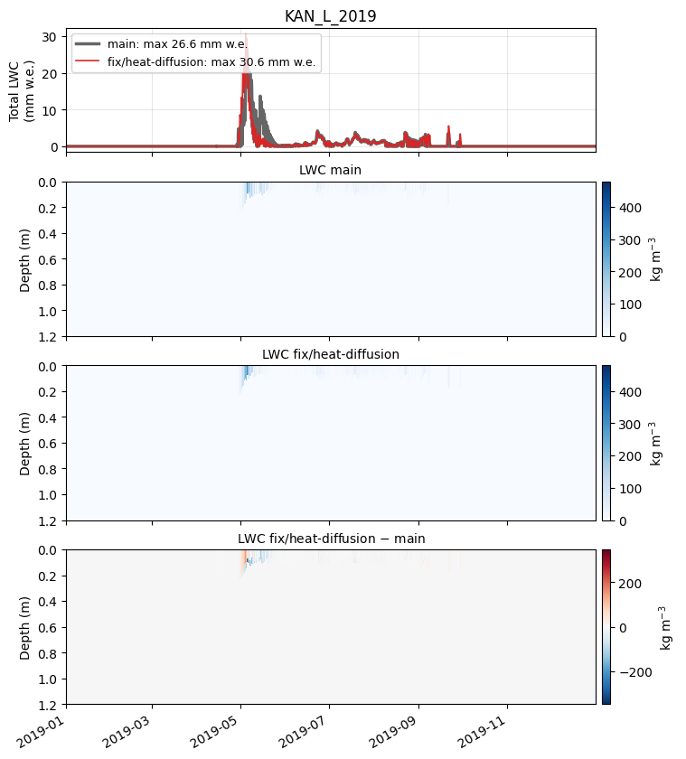

🤖 Generated with [Claude Code](https://claude.com/claude-code)
