## Changes

### 1. Runoff constants now reach the percolation scheme
- `perc_runoff_new` (numba-jitted, `lib/percolation.py`) hard-coded `t_runoff = 28513.8` s, `do_no_darcy = 0` and `avoid_runoff = 0`, ignoring `c.t_runoff`, `c.do_no_darcy` and `c.avoid_runoff`. They are now passed as arguments from `subsurface_opt`.
- `avoid_runoff = 1` could not have worked anyway: the test was `do_runoff & (~avoid_runoff)`, and `~` of an integer is −1 or −2, which is always true. It is now `do_runoff and not avoid_runoff`.
- With the previous slope (0.1), these changes alone give bit-identical outputs (checked).

### 2. Surface slope of the runoff time scale
The runoff time scale follows Zuo & Oerlemans (1996, eq. 22): t\* = c1 + c2·exp(−c3·S), with c1, c2, c3 as in Lefebre et al. (2003): 0.33 d, 25 d, 140. Zuo & Oerlemans use c1 = 1.5 d; Lefebre et al. lowered it because the scheme also drains excess water inside the snowpack, as in this model.

- **Old behaviour.** S came from an `ElevGrad` argument of `ImportConst` that no caller set, so it was always 0.1 (5.7°). With that slope, exp(−14) ≈ 10⁻⁶, so t\* = c1 = 0.33 d and the slope had no effect, the limit of a very steep surface. Neither paper uses that value.
- **New default.** S is the constant `surface_slope` in `const_subsurf.csv`, with default **0.02** as in Lefebre et al. (2003) at ETH Camp, so t\* = **1.85 d**.
- **Distributed runs.** If the surface input file has a variable `surface_slope` (tangent, m m⁻¹) for the station or grid point, `load_CARRA_data` uses it instead of the default; `altitude` and `latitude` are already read the same way. `run_SEB_firn` recomputes `c.t_runoff` (`runoff_time_scale(c)` in `lib/initialization.py`) after loading the input. Tested: with `surface_slope = 0.005` in the input file, t\* = 12.7 d.

| | c1 | c2 | c3 | S | t\* |
|---|---|---|---|---|---|
| Zuo & Oerlemans 1996 | 1.5 d | 25 d | 140 | fitted to the GIMEX transect | 1.5–26.5 d |
| Lefebre et al. 2003 | 0.33 d | 25 d | 140 | 0.02 | 1.85 d |
| main (before) | 0.33 d | 25 d | 140 | 0.1 | 0.33 d |
| this PR (default) | 0.33 d | 25 d | 140 | 0.02 | 1.85 d |

### Effect on the test runs
The test input files have no `surface_slope`, so they use 0.02. Excess meltwater now stays in the snow about 1.85 d instead of 0.33 d, so more of it refreezes:
- runoff at DY2_2012 drops by 0.020 m w.e.;
- at KAN_L, refreezing rises 24–34 % (+0.05 m w.e.) and runoff drops by 0.08–0.10 m w.e.;
- SMB rises 0.08–0.10 m w.e. at KAN_L;
- surface melt at KAN_L also drops slightly (−1 %).

## Effect on the test runs

Totals over each test case in m w.e. (fix/runoff-timescale vs main). Constant Tdeep = 263 K, no spin-up (initial profiles from input/initial state).

| Test case | Variable | main | fix/runoff-timescale | Difference | Difference (%) |
|---|---|---|---|---|---|
| DY2_2012 | Melt | 0.671 | 0.671 | -0.000 | -0.0 |
| DY2_2012 | Internal melt | 0.000 | 0.000 | +0.000 | n/a |
| DY2_2012 | Runoff | 0.029 | 0.010 | -0.020 | -67.2 |
| DY2_2012 | Refreezing | 0.683 | 0.703 | +0.020 | +2.9 |
| DY2_2012 | Sublimation | -0.001 | -0.001 | -0.000 | -6.9 |
| DY2_2012 | SMB | 0.558 | 0.577 | +0.020 | +3.5 |
| DY2_2019 | Melt | 0.153 | 0.153 | +0.000 | +0.0 |
| DY2_2019 | Internal melt | 0.000 | 0.000 | +0.000 | n/a |
| DY2_2019 | Runoff | 0.000 | 0.000 | +0.000 | n/a |
| DY2_2019 | Refreezing | 0.153 | 0.153 | +0.000 | +0.0 |
| DY2_2019 | Sublimation | 0.008 | 0.008 | +0.000 | +0.0 |
| DY2_2019 | SMB | 0.265 | 0.265 | +0.000 | +0.0 |
| KAN_L_2012 | Melt | 4.119 | 4.070 | -0.049 | -1.2 |
| KAN_L_2012 | Internal melt | 0.000 | 0.000 | +0.000 | n/a |
| KAN_L_2012 | Runoff | 4.159 | 4.063 | -0.096 | -2.3 |
| KAN_L_2012 | Refreezing | 0.192 | 0.239 | +0.047 | +24.3 |
| KAN_L_2012 | Sublimation | 0.049 | 0.049 | +0.000 | +0.2 |
| KAN_L_2012 | SMB | -3.679 | -3.583 | +0.096 | +2.6 |
| KAN_L_2019 | Melt | 4.455 | 4.423 | -0.032 | -0.7 |
| KAN_L_2019 | Internal melt | 0.000 | 0.000 | +0.000 | n/a |
| KAN_L_2019 | Runoff | 4.368 | 4.289 | -0.079 | -1.8 |
| KAN_L_2019 | Refreezing | 0.138 | 0.185 | +0.047 | +34.1 |
| KAN_L_2019 | Sublimation | -0.032 | -0.031 | +0.001 | +3.3 |
| KAN_L_2019 | SMB | -4.088 | -4.010 | +0.078 | +1.9 |

### DY2_2012

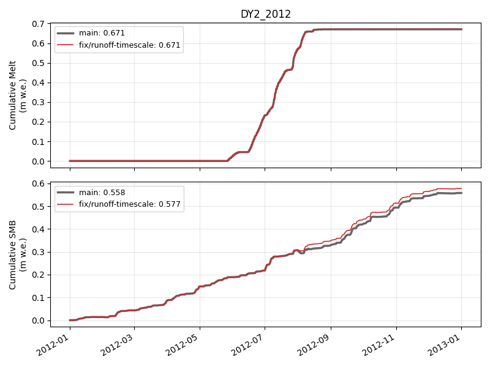

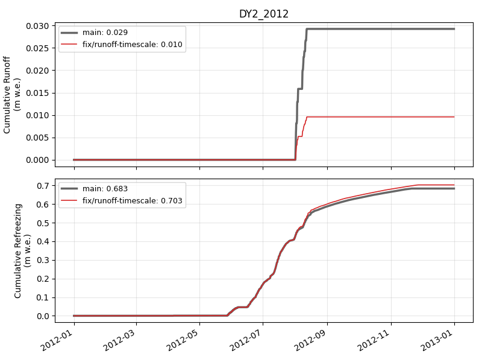

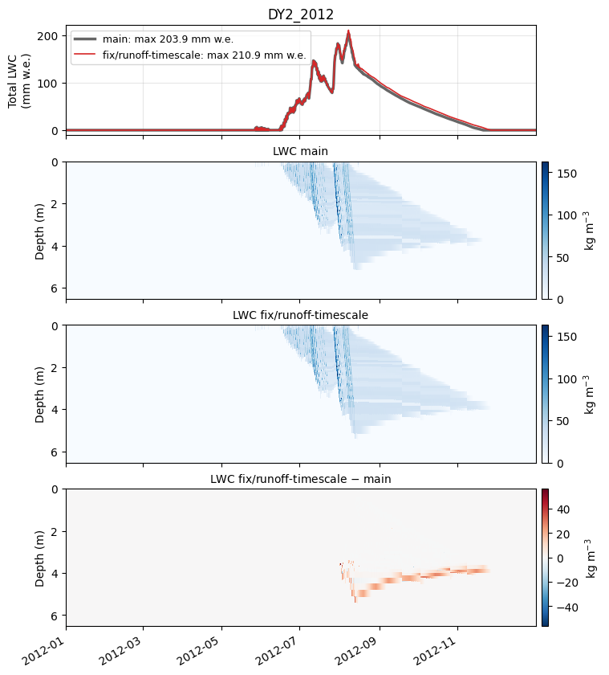

### DY2_2019

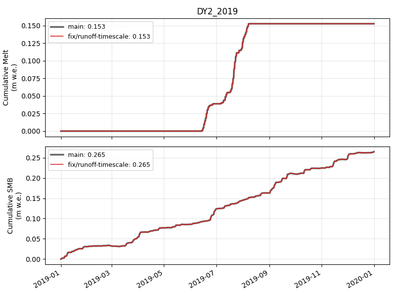

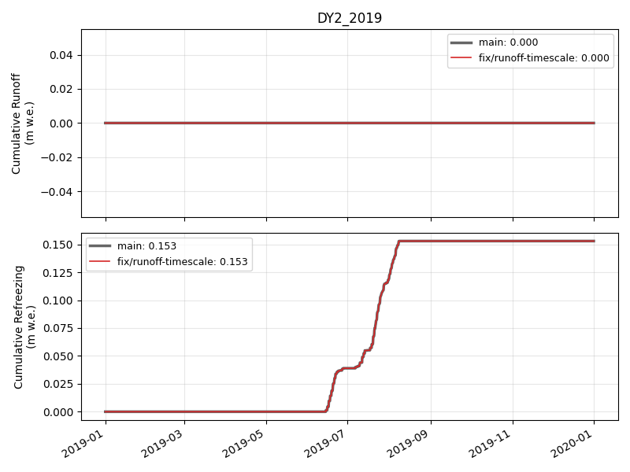

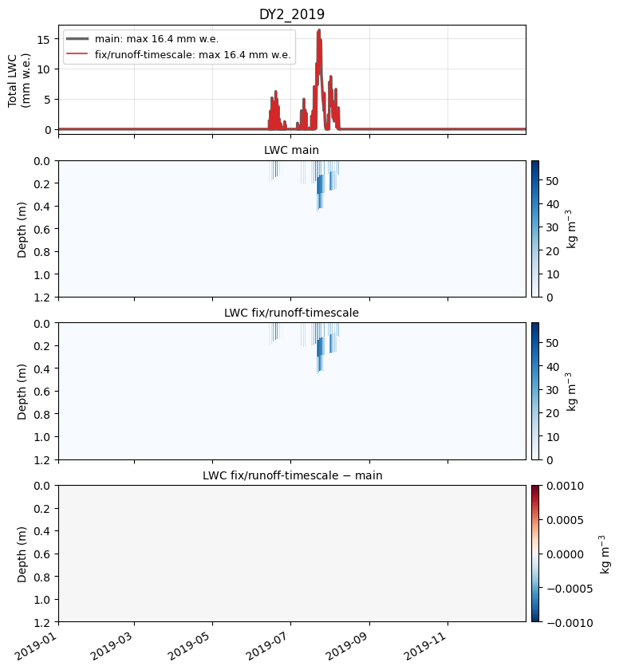

### KAN_L_2012

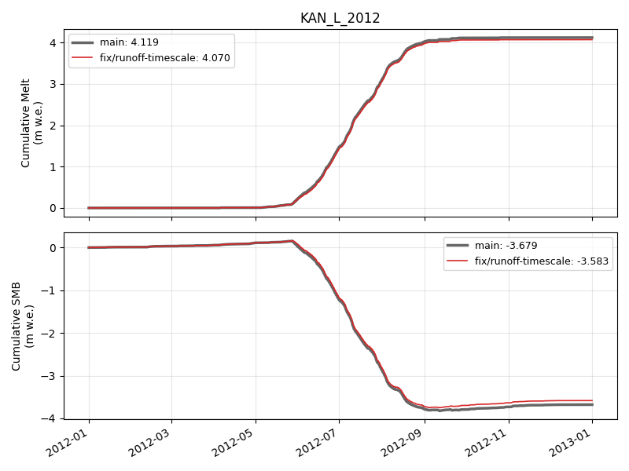

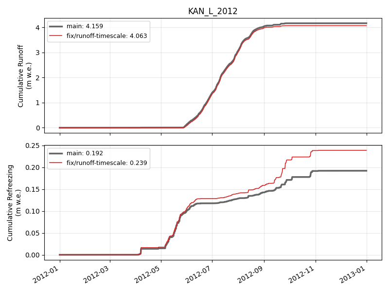

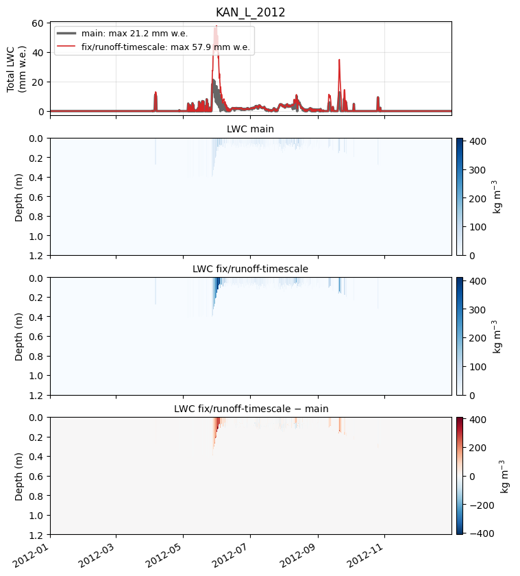

### KAN_L_2019

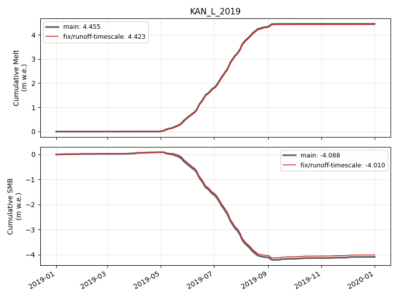

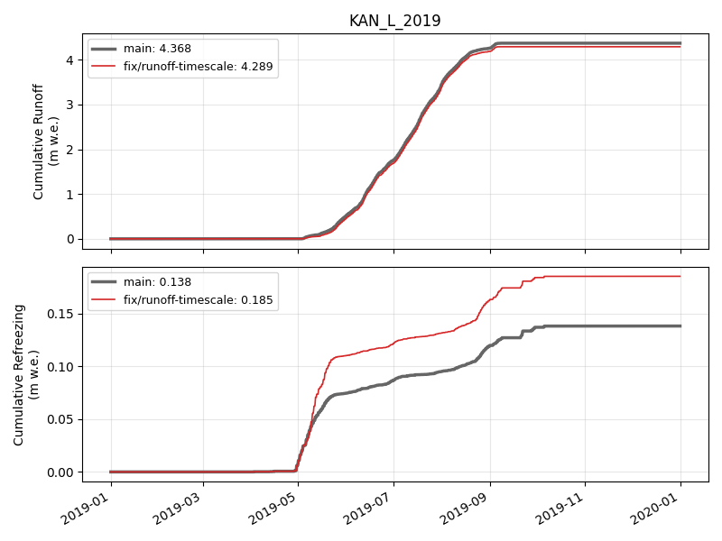

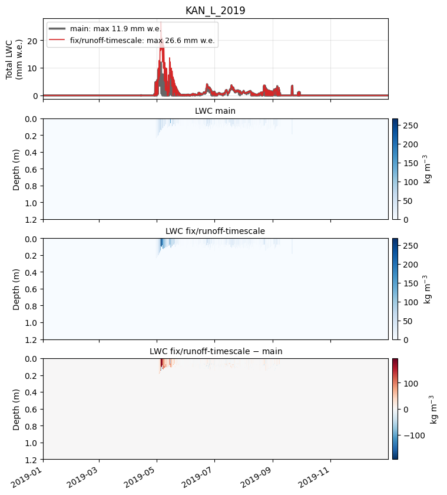

🤖 Generated with [Claude Code](https://claude.com/claude-code)
