## Changes

Small fixes in `lib/seb_smb_model.py`, `lib/subsurface.py` and `lib/initialization.py`. None of them changes the test runs by more than 0.001 m w.e.

1. **`variables_preparation`: `pres` used before it is defined.** When the forcing has relative humidity instead of specific humidity (AWS forcing), `SpecHumSat(RH, T, pres, c)` was called before `pres` was read: `NameError`. CARRA forcing has specific humidity, so it was not affected.
2. **Old-snow roughness length not capped.** Lefebre et al. (2003) go from `z0_old_snow` at 600 kg m⁻³ to `z0_ice` at 920 kg m⁻³. The density used (`rho[0, k]`) includes the liquid water, so wet snow can exceed 920 kg m⁻³ and get a roughness length larger than the ice one. It is now capped at `z0_ice`. This is the only change that affects the test runs (KAN_L_2012, < 0.0005 m w.e.).
3. **`ind_ice` for SW penetration.** It was `np.argmax(depth_m > snowthick)`, which returns 0 (all ice) when `snowthick` reaches the bottom of the column. That case became possible with the diagnosed `snowthick` of #20 at sites without ice layers. It is now the first ice layer of the column (`first_ice_layer`, the same criterion as `snowthick`). SW penetration is off by default, so there is no effect on the test runs.
4. **The "Problem closing energy budget" warning was never printed.** The test was `findbalance == c.iter_max_EB`, but `range(1, iter_max_EB)` stops at `iter_max_EB − 1`. It now prints when the iteration stopped without converging. In the 34-year runs at DY2, KAN_L, KAN_U and SWC this happens a few dozen times (out of 102 000 steps), and the unclosed imbalance counted as melt is about 10⁻⁴ m w.e. in total.
5. **Initial layers denser than ice.** The initial state used to be stored as snow (`snowc`, `rhofirn` = bulk density), except when the whole profile was exactly 900 kg m⁻³. Layers denser than the model's ice (e.g. up to 939 kg m⁻³ in the KAN_U profile) were kept as snow denser than ice: negative pore space, and a jump of the layer volume at the first densification step, which caps `rhofirn` at `rho_ice`. Now, in `IniVar`, every initial layer at or above `rho_ice` is ice (`snic`) with density `rho_ice`. The all-900 profile used at KAN_L (ablation profile) is converted as before. At KAN_U, one layer (2.55 m w.e.) is now ice.
6. **First time step after the initialization.** The heat diffusion coefficients, surface conductance and `snowthick` of the first step now come from the initial state, as at the end of every step (`update_tempdiff_params_opt`, `calc_snowthick_m`).
   - Before, a start from the initial-state csv files had `grndc = T`, `grndd = 0`: no heat exchange between the surface and the subsurface during the first step, and `snowthick = snowthick_ini`.
   - A start from a spin-up pickle used the saved coefficients without the matching surface conductance (#19), and `snowthick` was not set at all (`np.empty`).
   - This changes runoff at DY2_2012 by −0.001 m w.e. through the first steps; the other test cases change by less than 0.0005 m w.e.

## Effect on the test runs

Totals over each test case in m w.e. (fix/seb-small-fixes vs main). Constant Tdeep = 263 K, no spin-up (initial profiles from input/initial state).

| Test case | Variable | main | fix/seb-small-fixes | Difference | Difference (%) |
|---|---|---|---|---|---|
| DY2_2012 | Melt | 0.704 | 0.704 | +0.000 | +0.0 |
| DY2_2012 | Internal melt | 0.000 | 0.000 | +0.000 | n/a |
| DY2_2012 | Runoff | 0.023 | 0.022 | -0.001 | -4.7 |
| DY2_2012 | Refreezing | 0.702 | 0.703 | +0.001 | +0.2 |
| DY2_2012 | Sublimation | 0.000 | 0.001 | +0.000 | +0.3 |
| DY2_2012 | SMB | 0.564 | 0.565 | +0.001 | +0.2 |
| DY2_2019 | Melt | 0.265 | 0.265 | +0.000 | +0.0 |
| DY2_2019 | Internal melt | 0.000 | 0.000 | +0.000 | n/a |
| DY2_2019 | Runoff | 0.000 | 0.000 | +0.000 | n/a |
| DY2_2019 | Refreezing | 0.248 | 0.248 | +0.000 | +0.0 |
| DY2_2019 | Sublimation | 0.006 | 0.006 | +0.000 | +0.1 |
| DY2_2019 | SMB | 0.278 | 0.278 | +0.000 | +0.0 |
| KAN_L_2012 | Melt | 4.420 | 4.420 | +0.000 | +0.0 |
| KAN_L_2012 | Internal melt | 0.000 | 0.000 | +0.000 | n/a |
| KAN_L_2012 | Runoff | 4.345 | 4.345 | -0.000 | -0.0 |
| KAN_L_2012 | Refreezing | 0.190 | 0.190 | +0.000 | +0.2 |
| KAN_L_2012 | Sublimation | 0.041 | 0.041 | -0.000 | -0.0 |
| KAN_L_2012 | SMB | -3.775 | -3.774 | +0.000 | +0.0 |
| KAN_L_2019 | Melt | 4.688 | 4.688 | -0.000 | -0.0 |
| KAN_L_2019 | Internal melt | 0.000 | 0.000 | +0.000 | n/a |
| KAN_L_2019 | Runoff | 4.506 | 4.506 | -0.000 | -0.0 |
| KAN_L_2019 | Refreezing | 0.132 | 0.132 | -0.000 | -0.1 |
| KAN_L_2019 | Sublimation | -0.036 | -0.036 | -0.000 | -0.1 |
| KAN_L_2019 | SMB | -4.293 | -4.293 | -0.000 | -0.0 |

### DY2_2012

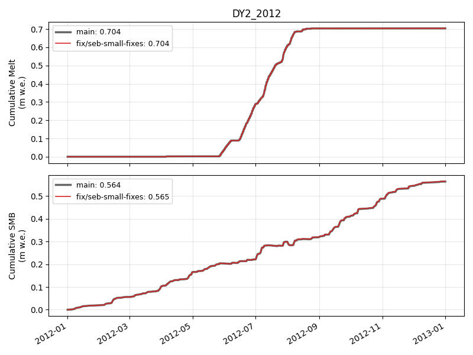

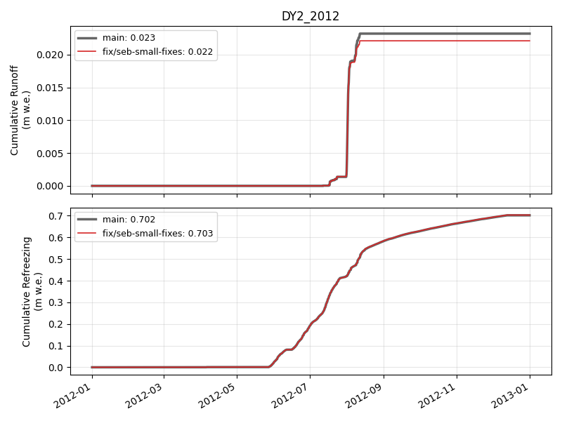

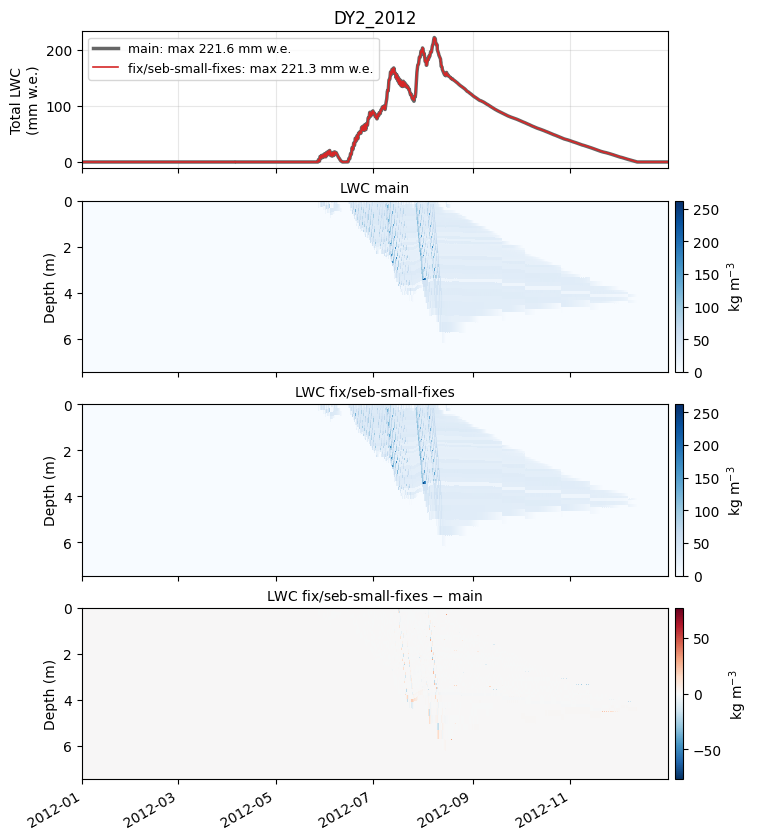

### DY2_2019

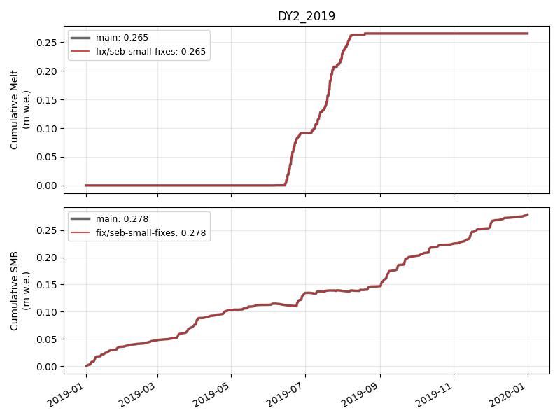

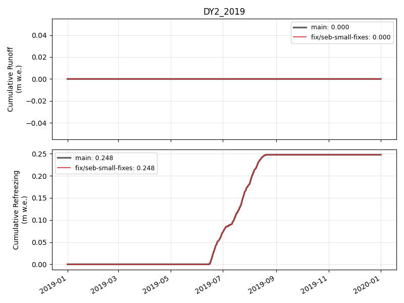

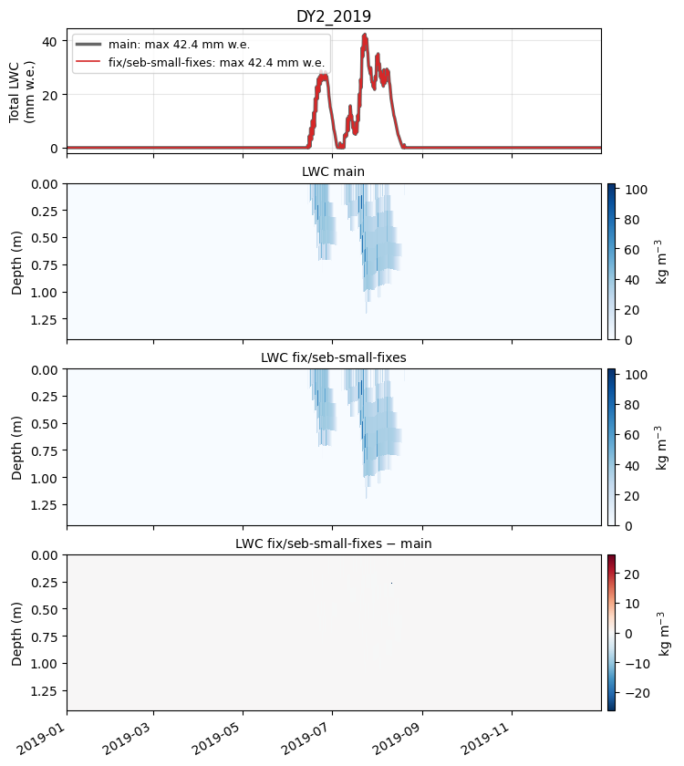

### KAN_L_2012

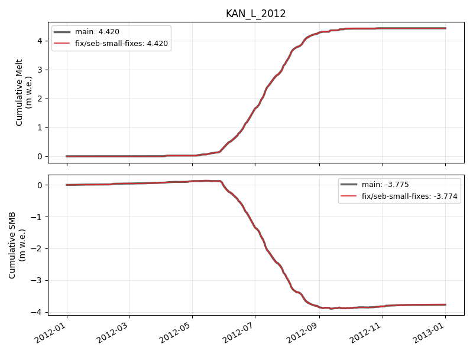

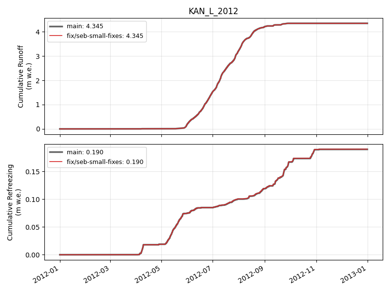

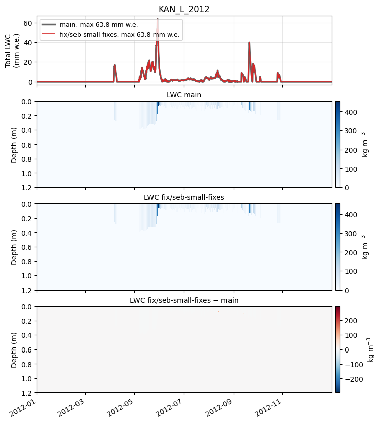

### KAN_L_2019

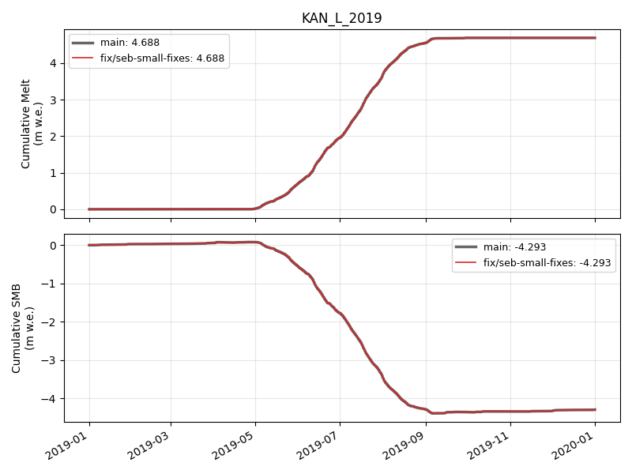

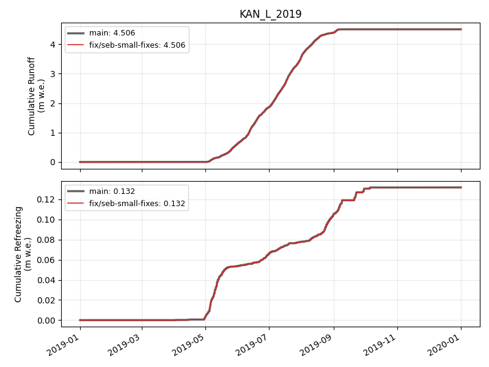

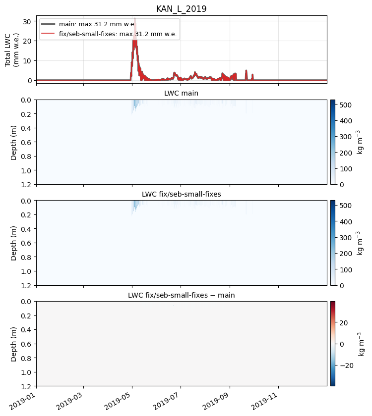

🤖 Generated with [Claude Code](https://claude.com/claude-code)
