## Changes

Fixes in the SMB output, the snow model and the input reading.

### 1. Sign of sublimation in the SMB output (`main_SEB_firn.py`)
`sublimation_mweq > 0` is deposition (mass gain; LHF > 0). It is already added to the snowfall that goes into the subsurface model, but `smb_mweq` subtracted it: `smb = snowfall + rainfall − runoff − sublimation_mweq`. Now `+ sublimation_mweq`. This affects only the SMB output, not the model's mass, and changes SMB by twice the net sublimation: +0.08 m w.e. at KAN_L_2012, −0.07 m w.e. at KAN_L_2019.

### 2. Mass lost in `sublimation()` on bare ice (`lib/subsurface.py`)
When sublimation leaves the top layer thinner than `lim_new_lay`, it is merged into the second layer, and `split_layer` then frees the top layer by discarding its content. The ice, water and temperature of the top layer were only merged when one of the two layers had snow. On bare ice, the top layer was simply deleted: up to `lim_new_lay` (0.05 m w.e.) each time.
- They are now merged in all cases.
- The merge also happens when the top layer has no frozen material left. Before, this caused a division by zero; with the fix alone it would have been an infinite loop.

Checked by running main's `sublimation()` on copies of the same inputs at every step of the test runs: it lost 0.050 m w.e. once at KAN_L_2019 (982 steps with net sublimation), and never in the other cases.

### 3. Energy conservation in `refreeze()`
- The amount refrozen used `cpiceF(T)`, but the warming used `cpiceF(T_0)`.
- The new ice (frozen at 0 °C) was given the warmed temperature without its heat.
- The temperature after refreezing now conserves the cold content: `(cfrozen + zrfrz)·cp·(T_0 − T_new) = cfrozen·cp·(T_0 − T) − zrfrz·L_fus`. A layer that refreezes its full potential ends exactly at 0 °C.

### 4. `snowthick` diagnosed from the column
`snowthick` (m) is used to choose between the smooth- and rough-surface turbulent fluxes and roughness lengths, and to split snow and ice for SW penetration. It was updated with snowfall, sublimation and melt, minus the compaction of **the whole column** (`dH_comp`). In the 1-year test runs starting from 0.1 m, the firn compaction kept it at 0 for most of the year: at DY2_2019 **50 % of the time (January–August)**, so DY2 was treated as a bare-ice surface. It is now the thickness of the layers above the first ice layer (ice > `icemax` of the layer mass, as in `calc_snowdepth1D`) plus the snow bucket (`calc_snowthick_m`), recomputed at each step. It is never 0 at DY2, and 0 on bare ice at KAN_L.

### 5. Smaller fixes
- `split_layer`: the ice layer added at the bottom of the column got `prhofirn = 1` kg m⁻³; now `rho_ice`. It has no snow, so this has no effect on the results.
- `load_CARRA_data`: a time-varying altitude takes its first value. The test for it (`len(altitude) > 0`) failed for a scalar altitude and was true for an altitude on the `station` dimension, where `isel(time=0)` fails. It now tests for a `time` dimension.

### Effect on the test runs
- **SMB:** the sign fix (1) changes SMB by twice the net sublimation.
- **DY2:** the `snowthick` fix (4) changes melt: −0.024 m w.e. in 2012, +0.031 in 2019 (the extra melt refreezes). It also changes sublimation, because the surface is no longer treated as bare ice for half the year. Without fix 4, melt, runoff and refreezing are unchanged to 0.001 m w.e. at both sites (attribution run).
- **KAN_L:** fix 4 changes melt by −0.02 and +0.003 m w.e.
- **Fixes 2 and 3** change refreezing by at most 0.005 m w.e.

## Effect on the test runs

Totals over each test case in m w.e. (fix/smb-sublimation-sign vs main). Constant Tdeep = 263 K, no spin-up (initial profiles from input/initial state).

| Test case | Variable | main | fix/smb-sublimation-sign | Difference | Difference (%) |
|---|---|---|---|---|---|
| DY2_2012 | Melt | 0.727 | 0.704 | -0.024 | -3.2 |
| DY2_2012 | Internal melt | 0.000 | 0.000 | +0.000 | n/a |
| DY2_2012 | Runoff | 0.034 | 0.023 | -0.011 | -32.1 |
| DY2_2012 | Refreezing | 0.714 | 0.702 | -0.011 | -1.6 |
| DY2_2012 | Sublimation | -0.005 | 0.000 | +0.006 | +109.8 |
| DY2_2012 | SMB | 0.557 | 0.564 | +0.006 | +1.1 |
| DY2_2019 | Melt | 0.234 | 0.265 | +0.031 | +13.3 |
| DY2_2019 | Internal melt | 0.000 | 0.000 | +0.000 | n/a |
| DY2_2019 | Runoff | 0.000 | 0.000 | +0.000 | n/a |
| DY2_2019 | Refreezing | 0.217 | 0.248 | +0.030 | +13.9 |
| DY2_2019 | Sublimation | -0.004 | 0.006 | +0.010 | +243.8 |
| DY2_2019 | SMB | 0.277 | 0.278 | +0.002 | +0.6 |
| KAN_L_2012 | Melt | 4.443 | 4.420 | -0.023 | -0.5 |
| KAN_L_2012 | Internal melt | 0.000 | 0.000 | +0.000 | n/a |
| KAN_L_2012 | Runoff | 4.373 | 4.345 | -0.028 | -0.6 |
| KAN_L_2012 | Refreezing | 0.183 | 0.190 | +0.006 | +3.5 |
| KAN_L_2012 | Sublimation | 0.041 | 0.041 | +0.000 | +0.1 |
| KAN_L_2012 | SMB | -3.885 | -3.775 | +0.110 | +2.8 |
| KAN_L_2019 | Melt | 4.684 | 4.688 | +0.003 | +0.1 |
| KAN_L_2019 | Internal melt | 0.000 | 0.000 | +0.000 | n/a |
| KAN_L_2019 | Runoff | 4.502 | 4.506 | +0.005 | +0.1 |
| KAN_L_2019 | Refreezing | 0.130 | 0.132 | +0.002 | +1.7 |
| KAN_L_2019 | Sublimation | -0.035 | -0.036 | -0.001 | -2.6 |
| KAN_L_2019 | SMB | -4.218 | -4.293 | -0.075 | -1.8 |

### DY2_2012

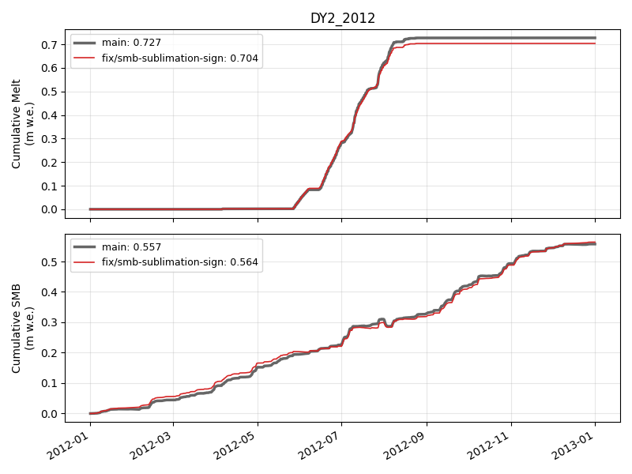

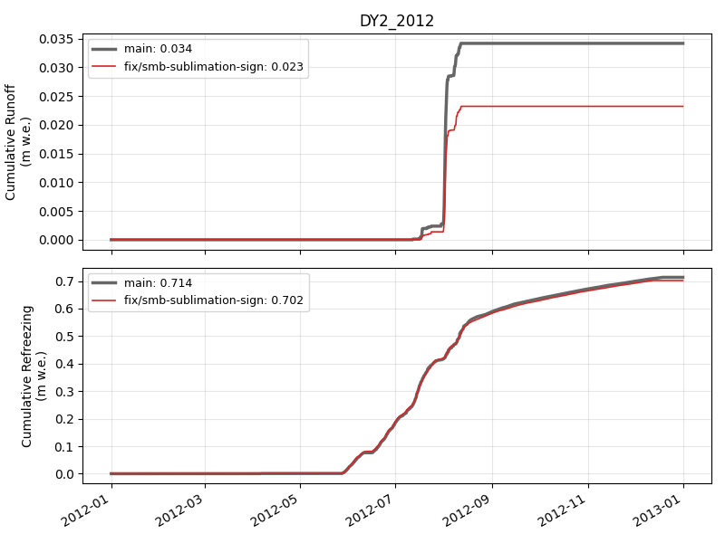

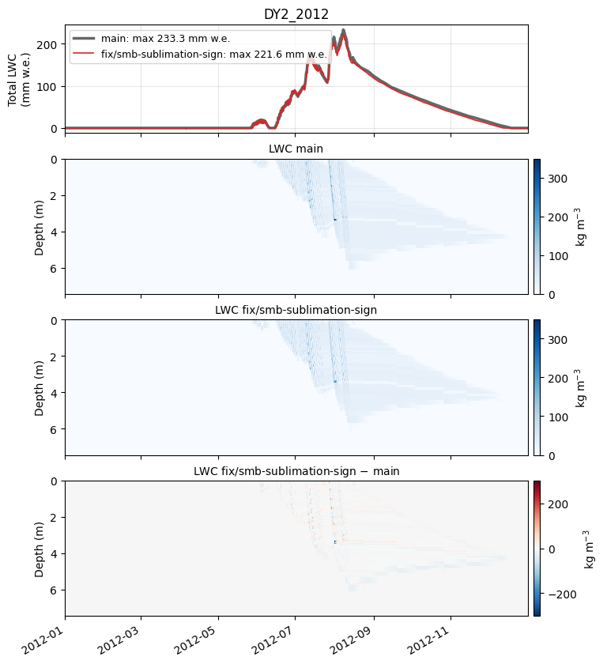

### DY2_2019

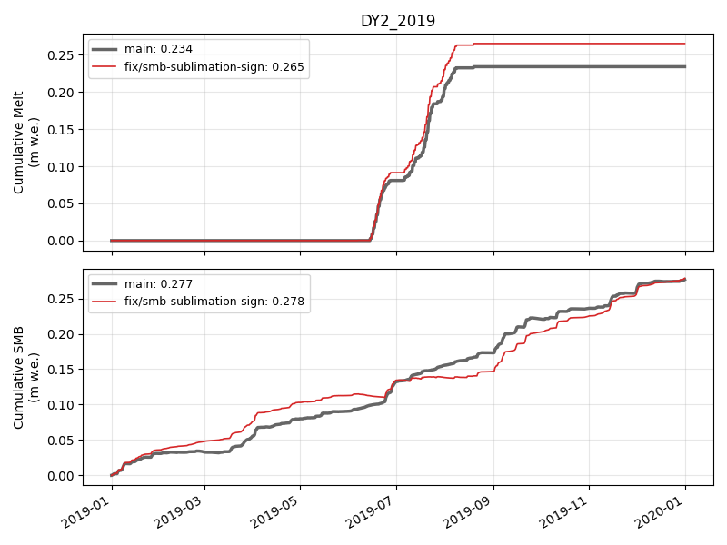

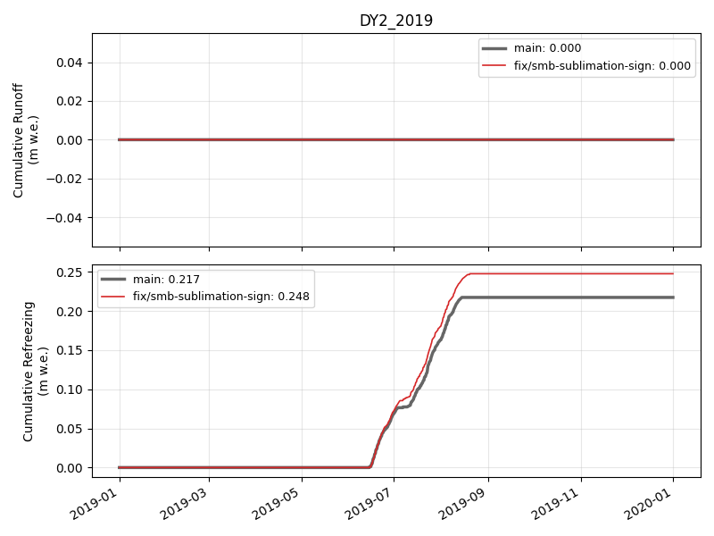

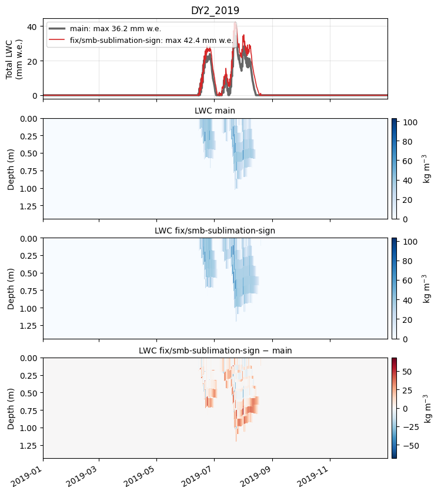

### KAN_L_2012

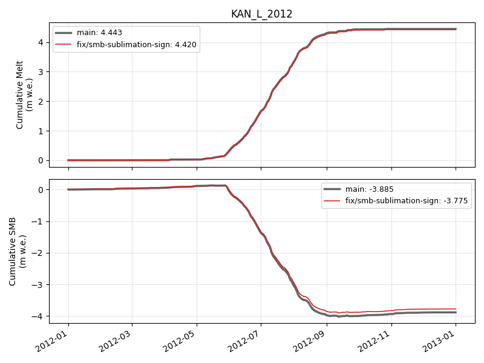

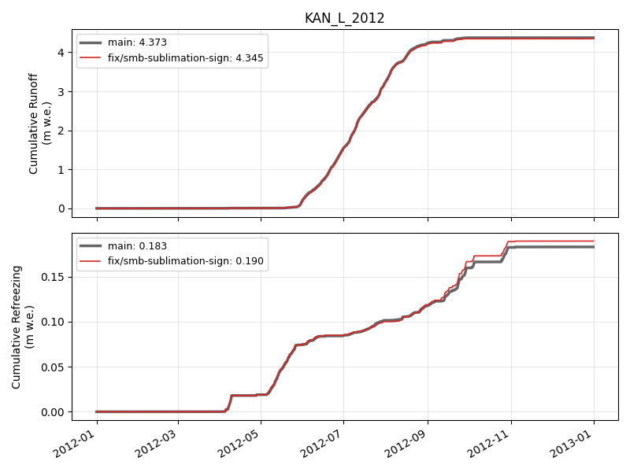

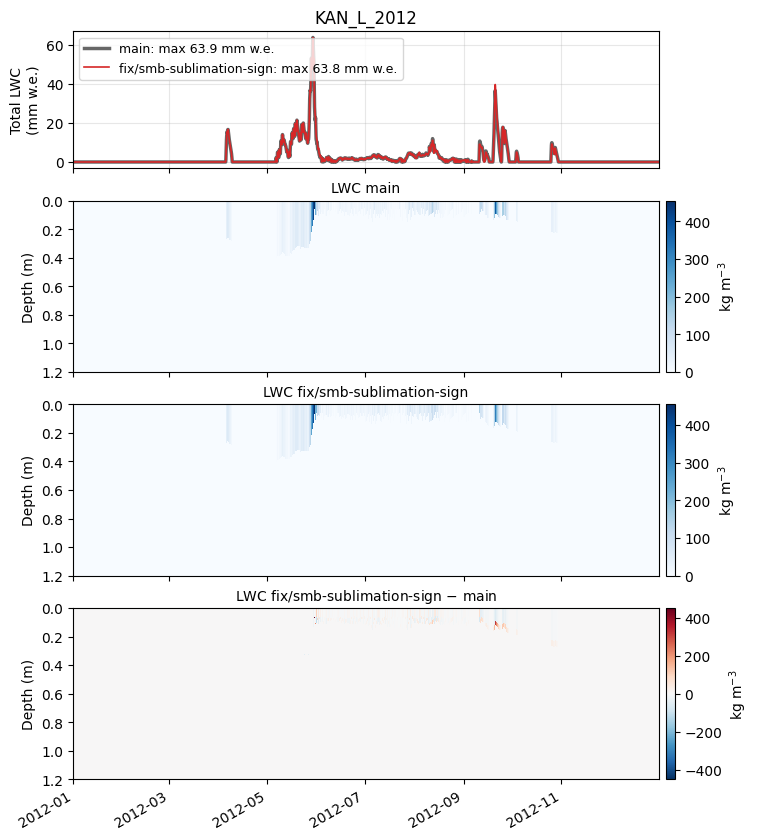

### KAN_L_2019

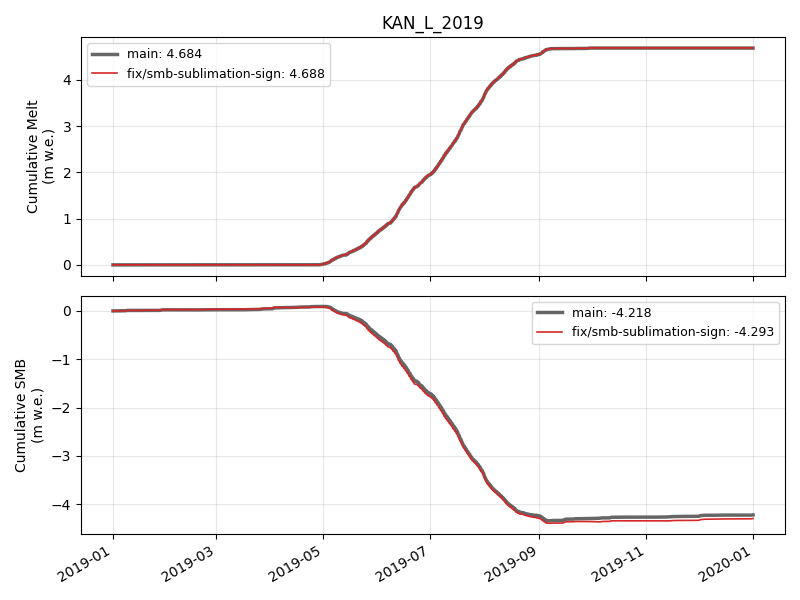

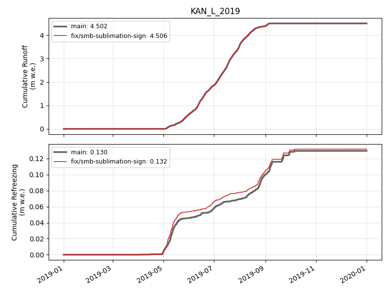

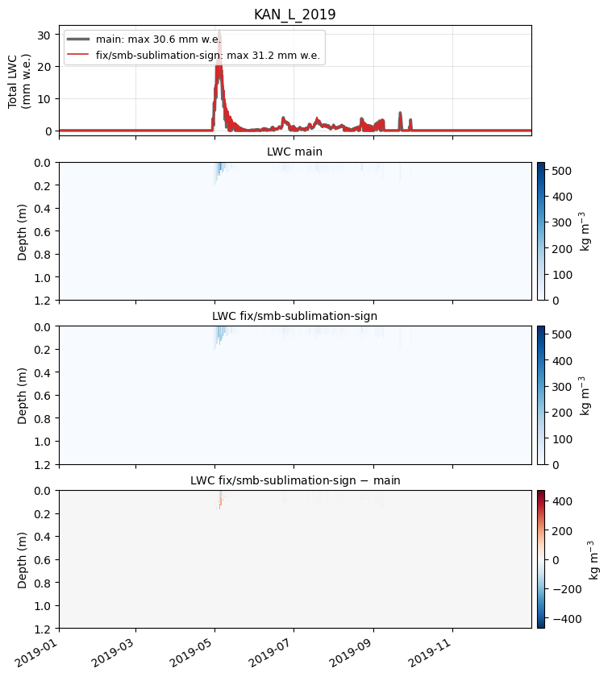

🤖 Generated with [Claude Code](https://claude.com/claude-code)
